<div align="center">

# SOWSprint.ai

**The three days between a client's brief and a signed Statement of Work, compressed to
three minutes.**

An autonomous multi-agent platform that reads a messy B2B requirement — a paragraph, a
bullet list, a voice note recorded on a phone — and produces an enforceable, jurisdiction-aware
contract together with the delivery plan to execute it.

[](https://sowsprintai-tr52wy95c3da5fg2ewqwj3.streamlit.app)

[](https://github.com/SergeyGer/SOWSprint.ai/actions/workflows/ci.yml)
[](https://github.com/SergeyGer/SOWSprint.ai/actions/workflows/codeql.yml)
[](https://github.com/SergeyGer/SOWSprint.ai/wiki/Testing)
[](https://github.com/SergeyGer/SOWSprint.ai/wiki)
[](LICENSE)

[](https://github.com/SergeyGer/SOWSprint.ai/wiki/LLM-Quality)

<!-- BEGIN GENERATED BADGES — edit scripts/gen_badges.py, not this block -->
**Core stack** — each version is read from the file that governs it (`requirements.txt`, `requirements-dev.txt`, the CI matrix, the Dockerfile), so the badges cannot drift from what the repository declares. Each links to the technology's own documentation; for why these were chosen and what they do here, see the [wiki](https://github.com/SergeyGer/SOWSprint.ai/wiki/Architecture).

[](https://docs.python.org/3/) [](https://docs.docker.com/) [](https://langchain-ai.github.io/langgraph/) [](https://docs.chainlit.io/) [](https://qdrant.tech/documentation/) [](https://platform.openai.com/docs/) [](https://docs.anthropic.com/) [](https://docs.pydantic.dev/) [](https://docs.astral.sh/ruff/)
<!-- END GENERATED BADGES -->

**[📖 Engineering & product wiki →](https://github.com/SergeyGer/SOWSprint.ai/wiki)**

**[▶ Watch it work](docs/media/demo.mp4)** — 1:10, narrated, from a spoken brief to the
contract, a provisioned Jira project and a Notion page. The pipeline's thinking time is
compressed; nothing else is.

<a href="docs/media/demo.mp4">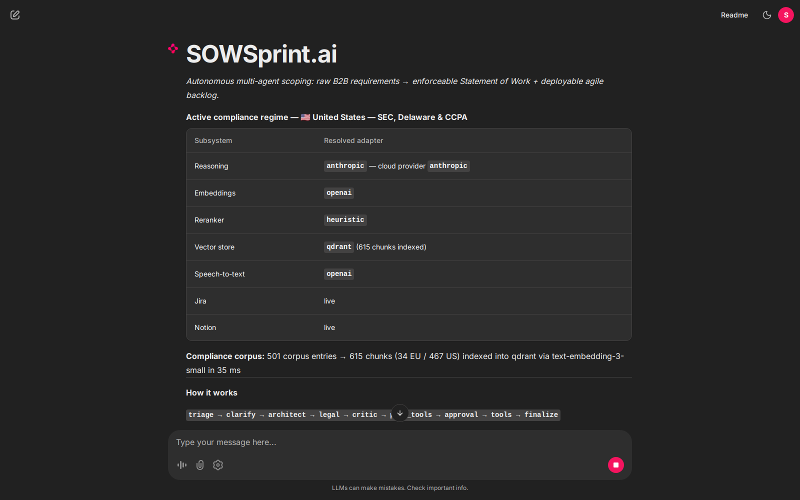</a>

<sub>The brief is **spoken**, not typed: the microphone records it, Whisper transcribes it, and
Triage extracts the scope and the regulatory triggers from what it heard. Then the contract is
drafted, audited, approved by a human, and provisioned — 25 dated Jira issues and a Notion
engagement summary, from one click.</sub>

</div>

---

## Start here

Three ways in, in increasing order of commitment. None of them needs an API key: the
deterministic engine drives the whole pipeline, and cloud models are an upgrade rather than a
prerequisite.

| | What you get | How |
| :-- | :-- | :-- |
| **No install** | Paste a brief, get a contract, a backlog and a compliance audit | **[Live demo →](https://sowsprintai-tr52wy95c3da5fg2ewqwj3.streamlit.app)** |
| **One command** | The full application: voice capture, approval gate, live Jira and Notion | `docker run --rm -p 8000:8000 ghcr.io/sergeyger/sowsprint.ai:latest` |
| **From source** | The same, plus the test suite and the ability to change it | see below |

<details>
<summary><b>Run it from source</b> — about 30 seconds, no credentials</summary>

```bash
git clone https://github.com/SergeyGer/SOWSprint.ai.git
cd SOWSprint.ai

python3 -m venv .venv && .venv/bin/pip install -r requirements-dev.txt

# No API keys needed: the deterministic engine runs every stage.
.venv/bin/python -m sowsprint.rag.ingest
.venv/bin/python scripts/demo_e2e.py --auto-deploy
```

Deliverables appear in `data/artifacts/<run-id>/`: a Statement of Work as Markdown and PDF, a
delivery backlog, a Jira-importable CSV, the quality audit, and a full run report.

Adding cloud models is an upgrade, not a prerequisite. One command checks every configured
service and prints the remedy for anything that fails:

```bash
.venv/bin/python scripts/probe_providers.py
```

**[Setup guide for VS Code →](docs/vscode.md)** ·
**[Deployment and operations →](https://github.com/SergeyGer/SOWSprint.ai/wiki/Operations)**

</details>

### Contents

**[The problem](#the-problem)** ·
**[What it does](#what-sowsprintai-does)** ·
**[See it working](#see-it-working)** ·
**[The impact](#the-impact)** ·
**[Who it is for](#who-it-is-for)**

**[Compliance, solved structurally](#compliance-is-the-hard-part-and-it-is-solved-structurally)** ·
**[The audit does not trust itself](#the-audit-does-not-trust-itself)** ·
**[Why it is not a wrapper](#why-this-is-more-than-a-wrapper-around-a-language-model)**

**[Documentation](#documentation)** ·
**[Honest limitations](#honest-limitations)** ·
**[Project](#project)**

--

## The problem

Every B2B engagement begins the same way. A client sends a brief. Someone senior — a
solution architect, a delivery lead, a founder — spends **two to three days** working out
what is actually being asked for and writing it up. Then a delivery manager spends another
day turning it into a plan.

That work is skilled, necessary, and **almost never billed**. It sits in pre-sales.

The expensive part is not the time. It is that this is where ambiguity enters. A Statement of
Work that is silent on data protection, or that caps liability without defining the
carve-outs, does not fail when it is signed. It fails eight months later, in a dispute, when
the person who wrote it has moved to another project.

**[The economics, and where this is the wrong tool →](https://github.com/SergeyGer/SOWSprint.ai/wiki/Business-Case)**
---

## What SOWSprint.ai does

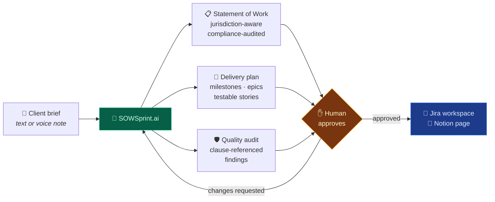

**Nothing is sent to a client's systems until a person approves it.** The approval screen
lists every planned action — the project key, each epic, each story — before anything
happens.

**[What each of the eight stages does →](https://github.com/SergeyGer/SOWSprint.ai/wiki/Agent-Pipeline)**
---

## See it working

### A brief arrives by voice

<p>
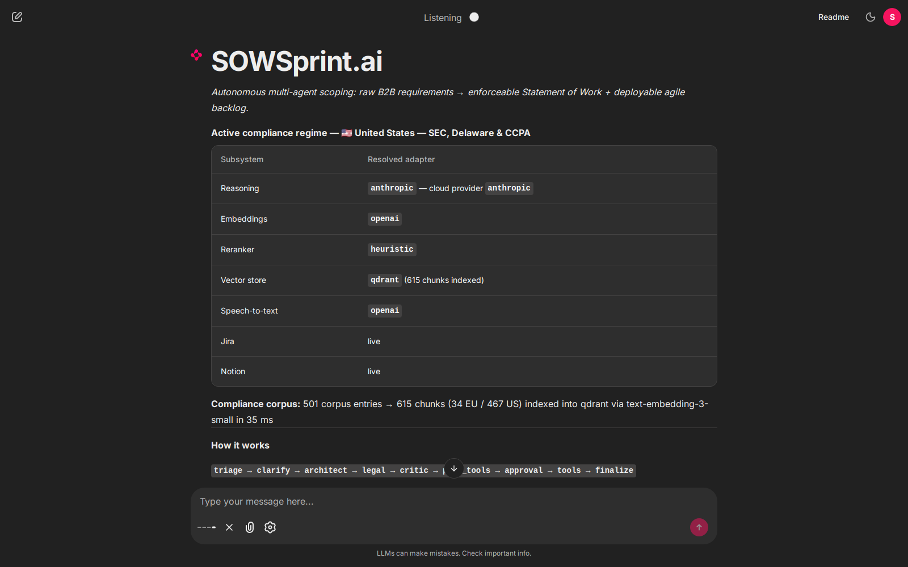

</p>

The microphone is real, and the transcript is Whisper's. Triage reads it and finds the
regulatory triggers in speech: GDPR, the EU AI Act, German BDSG, Irish law.

### The verdict comes first

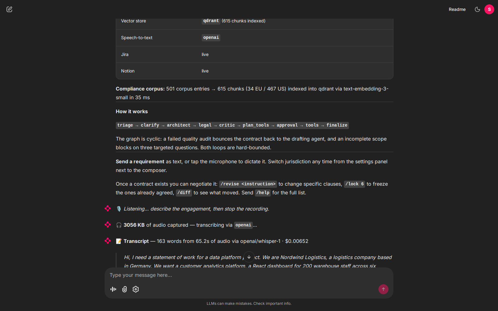

A finished engagement answers one question before any other: did it pass. The verdict is a
heading, with the score, the grounding ratio and the findings that produced it. When the
grounding cap decided the outcome rather than the findings, it says that instead — the two
call for different repairs.

### The approval gate

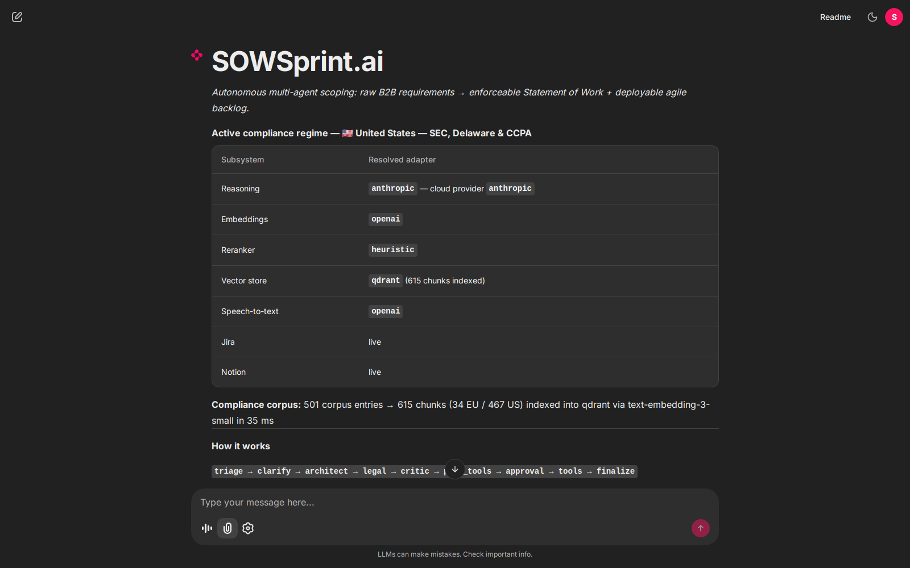

Nothing reaches Jira or Notion without a human. The gate states the schedule — start, planned
finish, duration — the roles the plan needs, and what will exist afterwards. It does not list
API calls; those are the pipeline's vocabulary, not the reader's.

### The plan at a glance

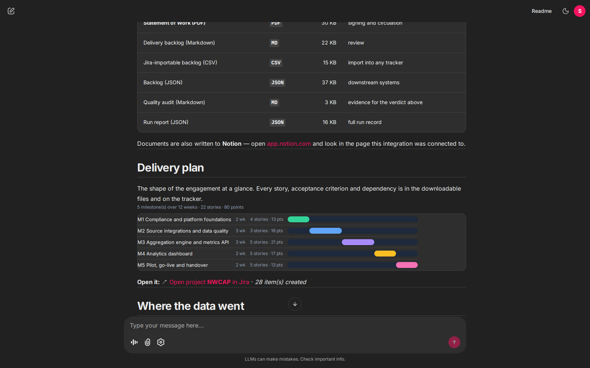

Milestones with duration and effort, drawn from the start date. Every story, acceptance
criterion and dependency stays in the downloadable files and on the tracker.

### The workspace, created

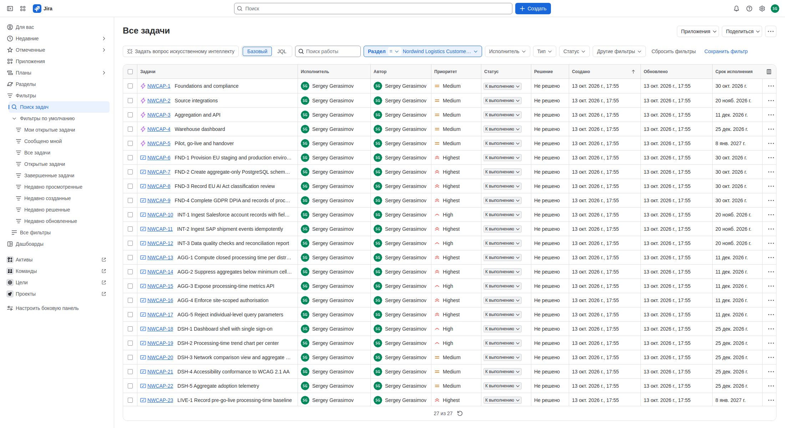

Every run provisions its **own** Jira project. This one holds 19 work items: each story
carries the epic it belongs to, the date it is due, and a priority. The dates are not typed
in — they come from the milestone schedule, so the backlog and the contract cannot disagree
about when anything lands.

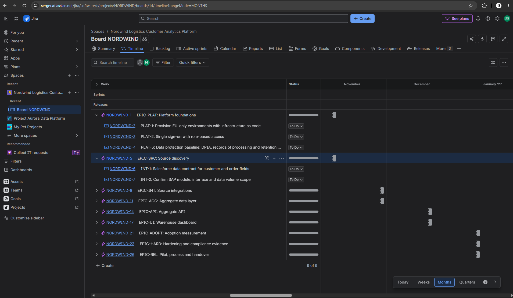

The same data in Jira's timeline view, where the shape of the engagement is visible at a
glance: platform foundations and source discovery in November, integrations and the data
layer through December, the dashboard, hardening and handover into January. Two months of
work that a reader can check against the contract in one look.

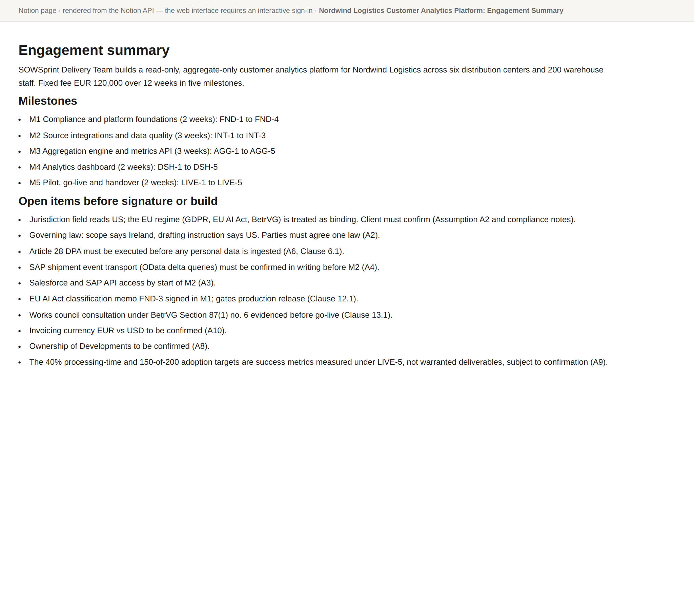

<sub>The Notion page, rendered from the Notion API — its web interface needs an interactive
sign-in, so this is the content Notion is serving rather than a screenshot of the app around
it. Milestones, the open items that must be settled before signature, and the assumptions the
draft rests on.</sub>

### Every document, and what each is for

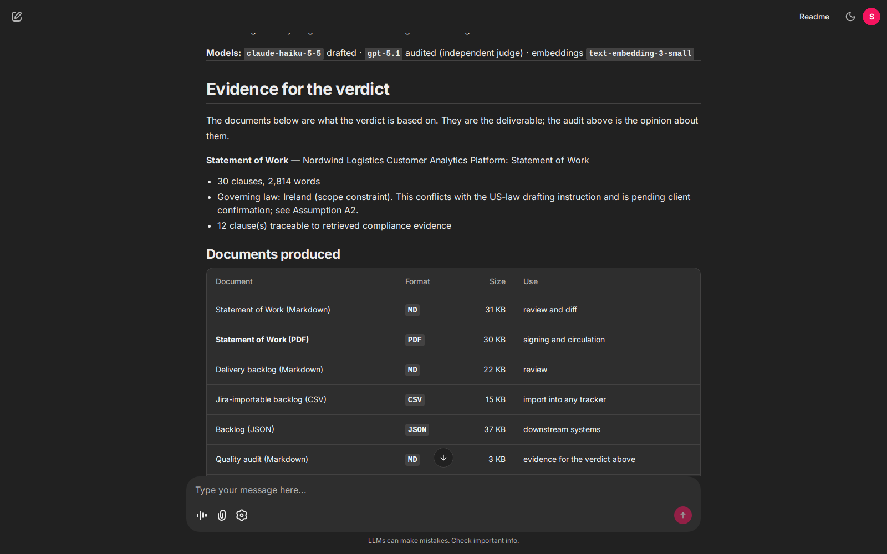

The format column matters in a way a file listing does not: PDF to sign, CSV to import into a
tracker, JSON for a downstream system, Markdown to review. Deselecting one saves rendering time
and disk, not model tokens — and the interface says so.

## The impact

| | Industry norm | SOWSprint.ai |
| :-- | :-- | :-- |
| Time to first draft | 1–2 weeks | **90–210 seconds** |
| Senior time per engagement | 20–50 hours | **1–3 hours** (review, not authorship) |
| Cost of the drafting itself | Not separately measured | **$0.05–0.20** |
| Compliance coverage | Depends who reviewed it | Checked against a tagged legal corpus, every time |
| Plan vs contract | Drift apart, written separately | Generated from one source, cannot diverge |

At a blended rate of €80/hour, a single engagement recovers roughly **€1,600–4,000** of
unbilled senior effort. A 12-person consultancy running three engagements a month is looking
at a six-figure annual figure that never appeared on a timesheet.

---

## Who it is for

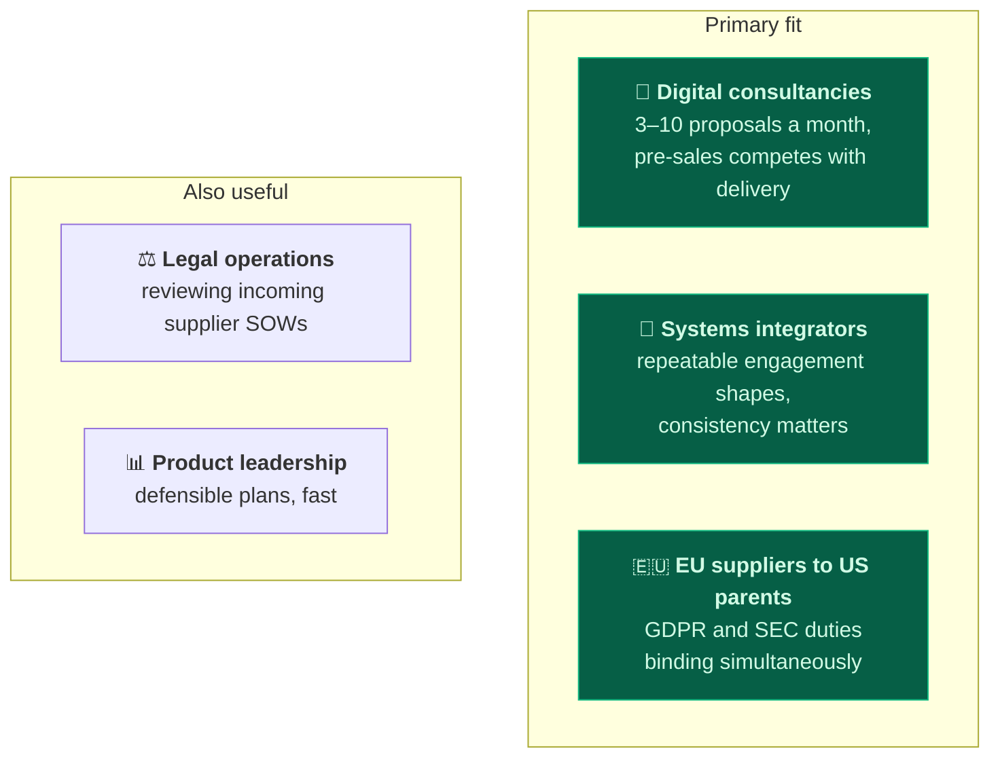

**[Full business case, including where this is the wrong choice →](https://github.com/SergeyGer/SOWSprint.ai/wiki/Business-Case)**

---

## Compliance is the hard part, and it is solved structurally

A contract bound by both European and American law is the case that breaks template-driven
drafting. A contract satisfying one regime is not a partial success — it is unenforceable in
the other.

SOWSprint.ai enforces the regime **inside the search engine**, not by asking a model nicely:

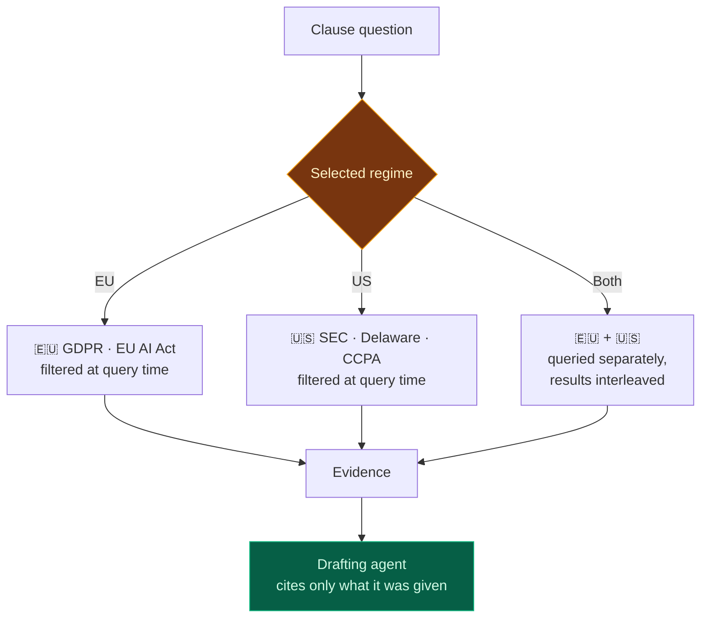

When both regimes apply, the platform produces **one contract that satisfies both**, with an
explicit rule for what happens when they conflict — because a contract silent on that point
is the trap.

**[How the compliance engine works →](https://github.com/SergeyGer/SOWSprint.ai/wiki/Compliance-RAG)**

---

## The audit does not trust itself

Language models invent defects as confidently as they find them. A judge that reports a
missing clause that is present is worse than no judge: it triggers a rewrite and burns a
reviewer's trust.

Observed live during development: a judge reported **eleven mandatory clauses absent** from a
contract that contained all eleven.

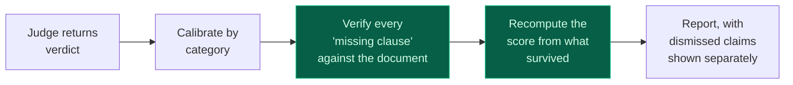

Every guard exists because of a specific failure that actually happened, and each one is
tested. Findings name the clause, the severity and the reasoning — for example:

> **Breach notification (15.1)** — the notification window is defined by reference to runbook
> clause numbering that is not part of the contract. This creates argument over when the
> window starts and what the limit is.

A reader in a hurry would not catch that. The audit did.

### The audit is measured, not asserted

Every project in this space claims an AI contract reviewer. Almost none publishes whether it
works. This one does:

```
15 injected defects · 15 found · 0 findings on a clean contract · 100% precision
```

`scripts/eval_audit.py` builds a contract that passes every check, then injects exactly one
defect into a copy — a removed GDPR clause, a fabricated citation id, a payment schedule that
sums to 80, a clause left as a placeholder — and reports whether the audit finds that defect
**and nothing else**. Two variants of most defect kinds, in different clauses, so the figure
measures that the checks work rather than that they exist.

Reproduce it in one command:

```bash
python scripts/eval_audit.py
```

The number is deliberately modest in what it claims: the corpus is synthetic and was written
alongside the checks, so it measures detection of **known, mechanical defect classes**, not
legal accuracy. What it rules out is the failure this category is full of — a reviewer that
finds nothing, or finds everything.

**[Quality assurance in depth →](https://github.com/SergeyGer/SOWSprint.ai/wiki/Quality-Assurance)** · **[How answer quality is measured, and what is not guaranteed →](https://github.com/SergeyGer/SOWSprint.ai/wiki/LLM-Quality)**

---

## Why this is more than a wrapper around a language model

Four things took real engineering, and each is documented rather than asserted:

| | |
| :-- | :-- |
| **Jurisdiction is enforced in the search engine** | A clause from the wrong regime cannot reach the drafting agent — it fails at query time on both retrieval paths, not in a prompt |
| **The audit verifies itself** | Claims are cross-checked against the document, severity is calibrated by category, and a verdict that came from a fallback is labelled as unreliable |
| **It works with no credentials at all** | The deterministic engine runs the entire pipeline, which is why 490 tests need no network and CI needs no secrets |
| **Nothing is autonomous where it matters** | Dry-run is the default, the approval gate lists every planned call, and the report states plainly what was and was not sent |

**[System design and the decisions behind it →](https://github.com/SergeyGer/SOWSprint.ai/wiki/Architecture)**
---

## Use it in a workflow

The whole pipeline is a GitHub Action. It needs no API key — the deterministic engine carries
it — and it fails the step when its own audit rejects the contract, because publishing a
contract the audit failed is worse than stopping.

```yaml
- uses: SergeyGer/SOWSprint.ai@v2.0.0
  id: sowsprint
  with:
    brief-file: brief.md        # or: brief: "one-paragraph requirement"
    jurisdiction: EU            # EU | US | BOTH
    output-dir: sow-out

- run: echo "audit ${{ steps.sowsprint.outputs.audit-passed }},
             score ${{ steps.sowsprint.outputs.quality-score }}"
```

It writes a Statement of Work (Markdown and PDF), a delivery backlog with testable acceptance
criteria, a Jira-importable CSV, the quality audit and a full run report — and attaches them to
the job. The audit verdict, score and grounding ratio are step outputs, so a workflow can gate
on them.

**[The action's inputs and outputs →](action.yml)**

---

## Documentation

**[→ Every documentation source, on one page](docs/README.md)** — where to start by role, and
which file answers which question.

| | |
| :-- | :-- |
| **[Business case](https://github.com/SergeyGer/SOWSprint.ai/wiki/Business-Case)** | The economics, and where this is the wrong tool |
| **[Who it is for](https://github.com/SergeyGer/SOWSprint.ai/wiki/Who-It-Is-For)** | Five buyer profiles, with the honest answer for each |
| **[Architecture](https://github.com/SergeyGer/SOWSprint.ai/wiki/Architecture)** | System design and the decisions behind it |
| **[Agent pipeline](https://github.com/SergeyGer/SOWSprint.ai/wiki/Agent-Pipeline)** | What each of the eight stages does |
| **[Quality assurance](https://github.com/SergeyGer/SOWSprint.ai/wiki/Quality-Assurance)** | How the audit is kept honest |
| **[LLM quality & reliability](https://github.com/SergeyGer/SOWSprint.ai/wiki/LLM-Quality)** | Which numbers decide a verdict, and what is **not** guaranteed |
| **[Corporate LLM & data residency](https://github.com/SergeyGer/SOWSprint.ai/wiki/Corporate-LLM)** | The on-premise roadmap item that unblocks enterprise adoption |
| **[Roadmap](https://github.com/SergeyGer/SOWSprint.ai/wiki/Roadmap)** | What is next, and what is deliberately not planned |
| **[Cost & observability](https://github.com/SergeyGer/SOWSprint.ai/wiki/Cost-Observability)** | Where the money goes |
| **[Security](https://github.com/SergeyGer/SOWSprint.ai/wiki/Security)** | Threat model, and the gaps |

Engineering practice: **[testing](https://github.com/SergeyGer/SOWSprint.ai/wiki/Testing)** · **[architecture decisions](https://github.com/SergeyGer/SOWSprint.ai/wiki/Decisions)** · **[VS Code setup](docs/vscode.md)** · **[runbook](docs/runbook.md)**

---

## Honest limitations

Stated here rather than buried, because overclaiming in a legal-adjacent product is how
people get hurt:

- **This is not legal advice.** It drafts and audits against a tagged corpus. It does not
  practise law, and the bundled corpus is not a substitute for counsel.
- **The audit is measured against synthetic defects, not against a lawyer's judgement.** It
  finds 15 of 15 injected mechanical defects with no collateral findings, which rules out the
  two common failures — an audit that finds nothing and an audit that finds everything. It
  does not tell you the audit is right about a contract a lawyer would consider subtly
  unbalanced. The **cloud** judge is not measured at all: that needs a pinned provider, a
  budget and a decision about which model defines the published figure.
- **The EU corpus is regulatory text, not precedent clauses.** No public dataset of EU
  contract clause language exists. US commercial clauses come from CUAD; EU material is
  GDPR, the AI Act and guidance, from which clauses are authored rather than retrieved.
- **No TLS, no role separation, in-memory sessions.** Fine for a LAN pilot, not for a shared
  deployment. → [Security](https://github.com/SergeyGer/SOWSprint.ai/wiki/Security)

**[The threat model, and the gaps →](https://github.com/SergeyGer/SOWSprint.ai/wiki/Security)**
---

## Project

Built with LangGraph, Chainlit, Qdrant and Docker · **490 tests** · MIT licensed

**[Latest release](https://github.com/SergeyGer/SOWSprint.ai/releases/latest)** — `v2.0.0`, published as `ghcr.io/sergeyger/sowsprint.ai:2.0.0`

**[Contributing](CONTRIBUTING.md)** · **[Security policy](SECURITY.md)** · **[Changelog](CHANGELOG.md)** · **[Code of conduct](CODE_OF_CONDUCT.md)**

<sub>The bundled compliance corpus is an adaptation of CUAD (CC BY 4.0) and Pile of Law, with
hand-authored material. It is a demonstration corpus, not a legal reference.</sub>
