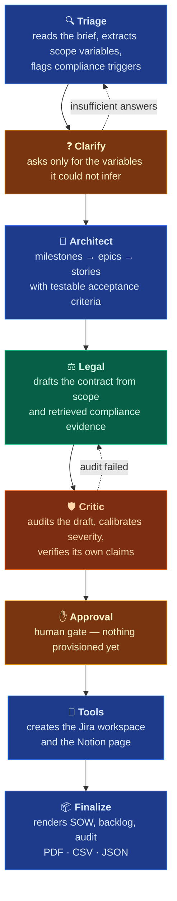
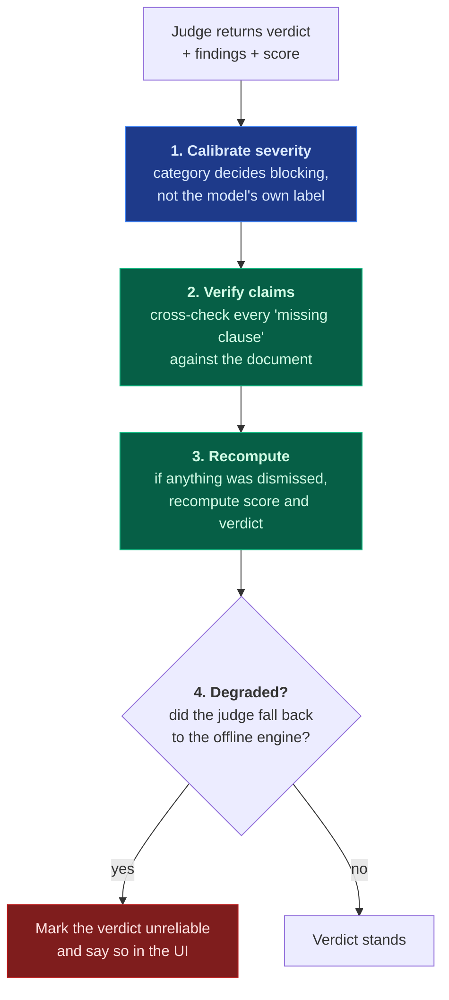
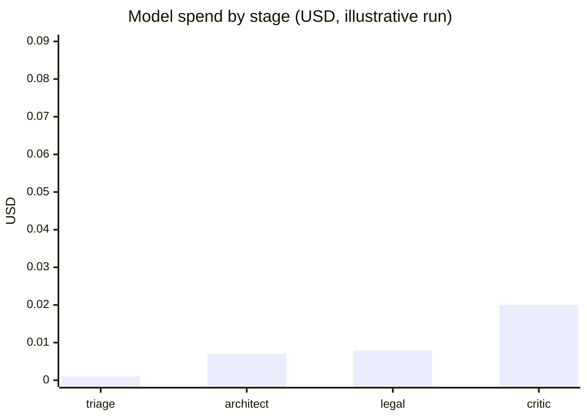

# Agent pipeline

Eight stages. Each is a method on `AgentNodes`, each takes and returns typed state, and
each emits step events the UI renders as they happen.

---

## 🔍 Triage — understanding what was actually asked

Extracts a `RequirementScope` from unstructured text: deliverables, business goal,
timeline, budget, user population, integrations, success metrics, and **compliance
triggers** (personal data, health data, financial data, employment data, AI decisions).

The critical design choice: **the model decides what it cannot infer.** Anything missing
from a critical set leaves the scope `INCOMPLETE`, and an incomplete scope does not
proceed to drafting. A Statement of Work written over an unresolved gap has no enforceable
subject matter, and no amount of good drafting downstream repairs that.

Observed live, and worth quoting because it is the behaviour that matters:

> *Regulatory triggers detected: possible employment data (unverified: staff-level
> reporting)*

The agent inferred from "200 warehouse staff" that employee personal data may be in scope,
and said so rather than assuming either way.

## ❓ Clarify — asking instead of guessing

Presents up to three questions, each with **why it blocks**, not just what is missing, plus
suggested answers drawn from similar past scopes. The user answers in one message.

Bounded at three rounds. After that the scope is accepted with **documented assumptions** —
injected into the contract's assumptions clause. The alternative, looping forever, is worse
than proceeding with a stated assumption that a human can challenge.

## 📐 Architect — from scope to plan

Produces a `TechnicalBlueprint`: milestones spanning the timeline, epics per workstream,
stories per epic, each with story points, dependencies and a definition of done.

The constraint that makes it useful: **every story carries acceptance criteria in
GIVEN/WHEN/THEN form**. A story that cannot be tested cannot be accepted, and "the user can
log in" is not an acceptance criterion. This is validated structurally — a story with fewer
than two criteria fails validation and is regenerated.

## ⚖️ Legal — drafting with evidence

Receives the scope, the blueprint and the **retrieved compliance passages**, and produces a
`SOWDocument`: numbered clauses, citations linking each clause back to specific retrieved
evidence, jurisdiction tags, a payment schedule, and assumptions.

The citation discipline is enforced: the prompt requires `id=` values that exist in the
retrieved evidence, and the audit checks that cited identifiers are real.

Clause templates differ by regime, and the dual-regime template adds three clauses that
only exist when EU and US obligations meet.
→ [Compliance-aware RAG](Compliance-RAG)

## 🛡️ Critic — the adversarial audit

A separate agent, and ideally a **separate vendor** from the drafter. A model auditing its
own output is measurably weaker at catching its own hallucinations, so the default
configuration deliberately splits them.

The Critic is where most of the engineering effort went, because a judge that is wrong in
either direction is worse than no judge:

Each step exists because of a specific observed failure. They are documented in
[Quality assurance](Quality-Assurance), including the one where a judge reported eleven
mandatory clauses absent from a contract containing all eleven.

## ✋ Approval — the human gate

Every planned tool call is listed **before** anything is sent: the workspace key, each epic,
each story. The reviewer sees what approving means, then approves, rejects, or asks for a
change in free text.

This gate is why the platform is deployable in a regulated environment. An autonomous
system with write access to a customer's Jira is not something a delivery director signs
off on; the same system with a review step is.

## 🔧 Tools — provisioning

Executes the approved plan through a tool registry, with **dry-run as the default**.
Dry-run validates every payload and shows it, then discards it. Going live is one setting,
and the report states plainly which mode ran.

## 📦 Finalize — artefacts

| Artefact | Purpose |
| :-- | :-- |
| `statement_of_work.md` / `.pdf` | The contract |
| `backlog.md` | Human-readable delivery plan |
| `jira_backlog.csv` | Importable, with an importer-safe variant |
| `backlog.json` | Machine-readable, for tooling |
| `quality_audit.md` | Clause-referenced findings |
| `run_report.json` | Full structured record of the engagement |

---

## Cost per stage

Measured on a real EU engagement, Claude Haiku drafting and GPT-5.1 auditing:

Two things are worth noting from the real numbers rather than the illustration:

- **The audit costs more than the drafting.** That is the right allocation: a false
  positive in the audit costs a full contract rewrite.
- **The judge is the largest single line item** at roughly $0.02 per engagement, against
  $0.05–0.20 total. It is also the component most worth spending on.

Prompt caching reduces repeat-call input cost by about 90% on the static persona and
schema prefix. → [Cost & observability](Cost-Observability)

→ [Architecture](Architecture) · [Quality assurance](Quality-Assurance)
