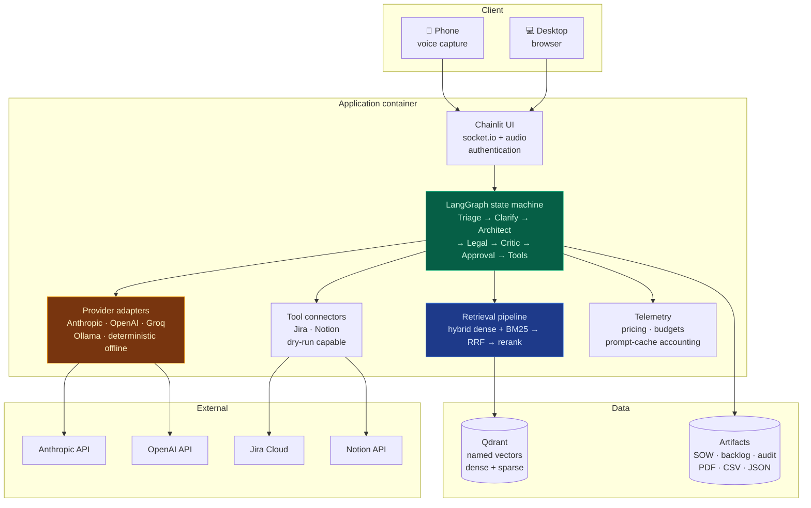
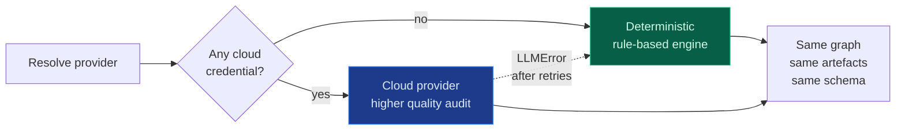
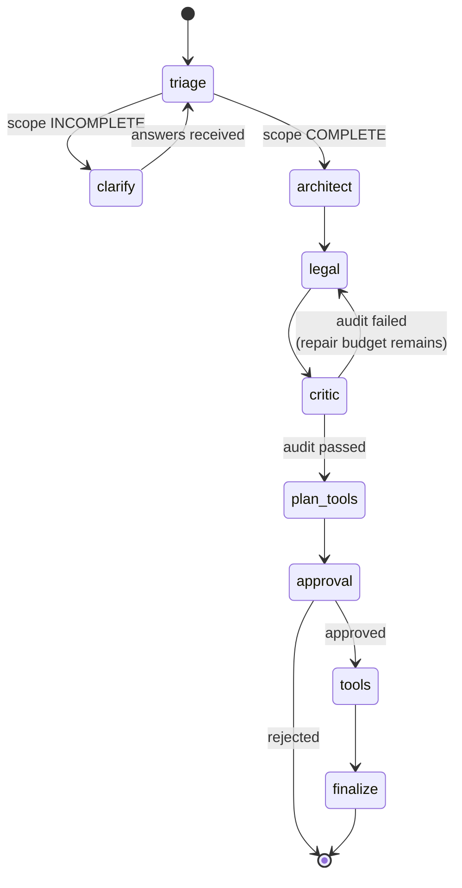
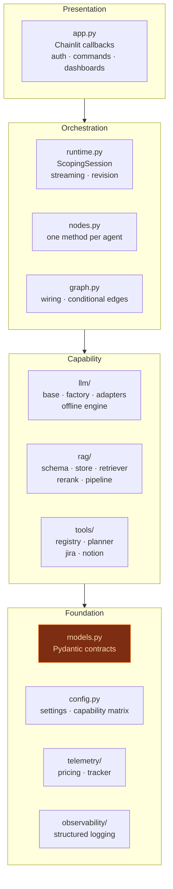

# Architecture

## System overview

## The single most important design decision

**Everything runs offline, and the cloud is an upgrade rather than a dependency.**

This is not a demo mode bolted on afterwards. It is the reason:

- **483 tests run with no network and no credentials**, so CI needs no secrets and a
  revoked key cannot break the build
- The graph, the schemas, the artefacts and the UI are identical either way, so the
  offline path exercises the real code
- A deployment can be demonstrated, evaluated and regression-tested before anyone signs a
  contract with a model provider
- The offline engine is also a **guardrail tier**: when a cloud call fails after retries,
  the run degrades rather than dying

The consequence, stated honestly: the offline auditor is a rule-based checker. Handed a
contract drafted by a language model it produces false findings, and the platform now
detects and reports that rather than presenting it as a verdict.
→ [Quality assurance](Quality-Assurance)

## The graph

A cyclic `StateGraph`, not a chain. The cycle is the repair loop: a failed audit returns
the draft to the drafting agent.

State is a typed dictionary carried through the graph and checkpointed with LangGraph's
`MemorySaver`, which is what makes human-in-the-loop interrupts resumable: the approval
gate can pause for minutes and resume from the exact node.

Every node returns a partial update plus **step events**, which the UI renders as they
arrive. The graph is synchronous; the UI drives it on a worker thread and consumes events
through a queue, so the event loop is never blocked by a two-minute run.

## Layering

**`models.py` is the contract layer**, and it is where the design pays off. Every agent
input and output is a Pydantic model, so:

- The LLM is asked for structured output against a generated JSON schema
- The offline engine produces the *same* models, so both paths are interchangeable
- A malformed model response is a retry, not a corrupt artefact
- The export layer renders from models and never re-parses text

## Why these technologies

| Choice | Reason | What it costs |
| :-- | :-- | :-- |
| **LangGraph** | Cyclic graph with typed state and interruptible human-in-the-loop. A chain cannot express "audit failed, go back". | Framework coupling around state shapes |
| **Chainlit** | Purpose-built chat UI with native audio capture and custom elements | Its custom-element mechanism turned out not to compile in this container — see [Decisions](Decisions) |
| **Qdrant** | Named vectors allow dense and sparse in one collection, and filters are applied inside the engine | A second container; an in-memory store mirrors the same filter semantics for tests |
| **Pydantic v2** | JSON-schema generation for structured output, plus validation at every boundary | Verbose models; worth it for the guarantees |
| **Docker Compose** | Two containers, one command, identical locally and in CI | Baked images rather than bind mounts, so source edits need a rebuild |

## Deliberate non-goals

- **No database.** Sessions are in-process and checkpointed in memory. Persistence is a
  roadmap item, not an oversight. → [Roadmap](Roadmap)
- **No multi-tenancy.** One deployment serves one organisation. Adding tenancy without
  understanding the compliance boundary would be worse than not having it.
- **No fine-tuning.** Retrieval and structured output solve the problem; fine-tuning would
  add a training pipeline and a drift surface for no measured gain.

→ [Agent pipeline](Agent-Pipeline) · [Compliance-aware RAG](Compliance-RAG) · [Decisions](Decisions)
