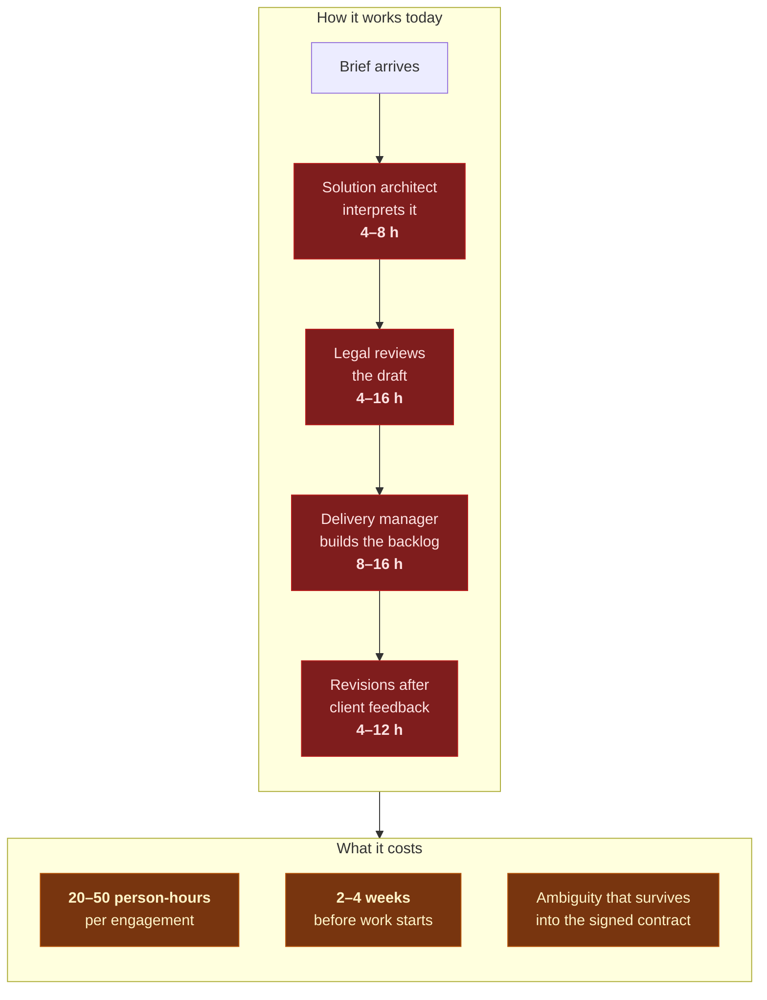
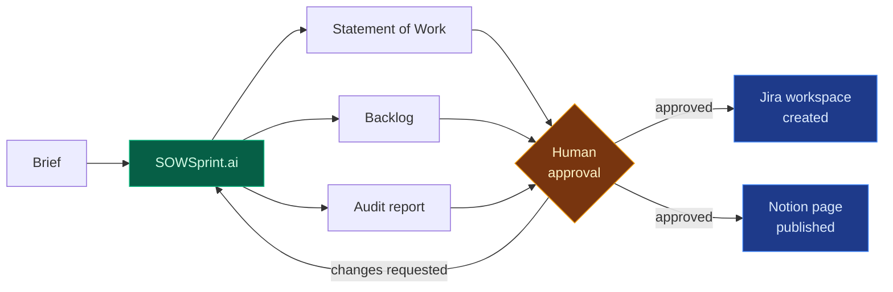
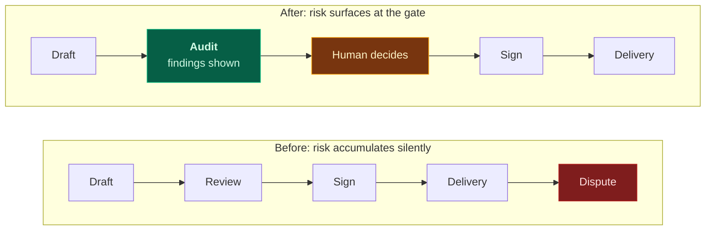

# Business case

## The cost that does not appear on any invoice

A B2B services engagement begins long before a contract exists. Someone senior — a
solution architect, a delivery lead, a founder — reads a client's brief, works out what
is actually being asked for, and writes it up as a Statement of Work. Then a delivery
manager turns that into a plan.

That work is real, skilled, and almost never billed. It sits in pre-sales.

The third cost is the expensive one. A Statement of Work that is silent on data
protection, or that states a liability cap without defining its carve-outs, does not fail
at signature. It fails eight months later, in a dispute, when the person who wrote it has
moved to another project.

## What the platform changes

| | Manual | SOWSprint.ai |
| :-- | :-- | :-- |
| Time to first draft | 1–2 weeks | **90–210 seconds** |
| Time to signed SOW | 3–6 weeks | **Same day** (review, not authorship) |
| Cost per engagement | 20–50 person-hours | **$0.05–0.20** of model spend |
| Compliance coverage | Depends who reviewed it | Checked against a tagged corpus, every time |
| Consistency | Varies by author | Reproducible and auditable |
| Backlog | Written separately, drifts from the SOW | Derived from the same scope object |

## The economics, stated honestly

The saving is **not** "the platform writes your contracts". It is that a human moves from
*authorship* to *review*. That is the whole of the value, and it is enough:

- 20–50 hours of senior time becomes 1–3 hours of review
- The review is better, because the reviewer has a compliance audit in front of them
  rather than a blank page
- The plan and the contract cannot drift apart, because both are generated from one
  scope object

At a blended rate of €80/hour, one engagement recovers roughly **€1,600–4,000** of
unbilled effort. A 12-person consultancy running three engagements a month is looking at
a six-figure annual figure that never appeared on a timesheet.

**What it does not do**, stated because overclaiming here would be dishonest: it does not
replace legal counsel, it does not know your commercial position, and it will not tell
you whether the deal is a good idea. It removes the blank-page problem and the
copy-paste-from-the-last-contract problem. Those are the two that consume the time.

## Where the risk actually moves

The platform does not remove legal risk; it moves it earlier, where it is cheap to fix.

Findings are named by clause, severity and reasoning, and the human sees them **before**
approving. The audit is not a rubber stamp: on this build it caught a breach-notification
window defined by reference to runbook clause numbers that were not part of the contract
— an unenforceable obligation that would have looked fine to a reader in a hurry.

→ [Who it is for](Who-It-Is-For.md) · [Quality assurance](Quality-Assurance.md) · [Roadmap](Roadmap.md)
