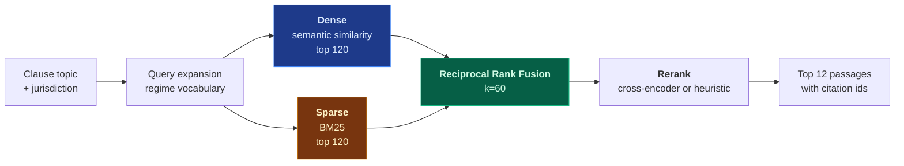
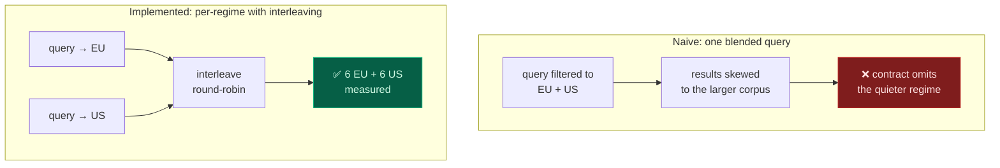
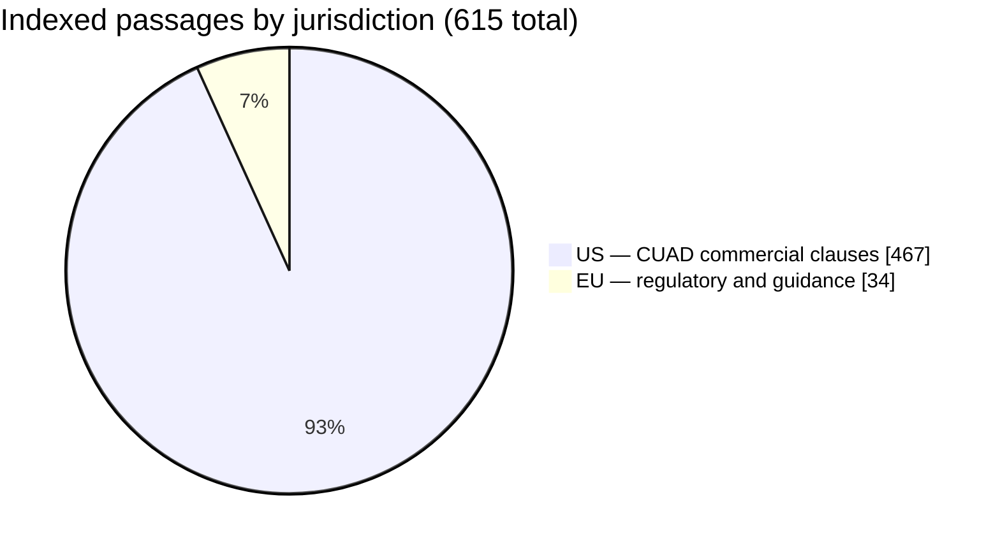

# Compliance-aware RAG

## Why jurisdiction is a filter, not a prompt instruction

The tempting design is to put "this is a German engagement, prefer GDPR" in the prompt and
trust the model. It fails quietly.

A retrieval query returns the top-K passages by similarity. If the corpus holds both EU and
US material, the US passages are frequently *more similar* — CUAD is 432 clauses of
commercial contract language, while the EU material is largely regulatory prose. The
drafting agent receives twelve Delaware-flavoured passages and nothing on GDPR, and writes
a confident, well-cited contract that is unenforceable in Germany. Nothing errors.

**So the filter is pushed into the vector engine**, applied to both retrieval arms, so a
clause from an unselected regime can never enter the candidate pool:

```python
# rag/schema.py — the filter is part of the query, not a post-hoc cleanup
must.append(FieldCondition(key="jurisdiction", match=MatchValue(value=jurisdiction)))
```

The in-memory fallback store mirrors this in `matches_filter`, and a test asserts the two
agree — because a fallback that filters differently is a fallback that produces different
contracts.

→ ADR: [Metadata filtering at query level](https://github.com/SergeyGer/SOWSprint.ai/blob/main/docs/adr/0002-metadata-filtering-at-query-level.md)

## The retrieval pipeline



**Why hybrid.** Dense retrieval finds passages that mean the same thing; BM25 finds passages
that say the same word. Legal text needs both — "GDPR Article 33" must match literally,
while "breach notification obligation" should match a passage that never uses the word
"breach".

**Why RRF rather than score normalisation.** Dense cosine scores and BM25 scores are not
commensurable; normalising them requires calibration that drifts as the corpus changes. RRF
uses only rank position, which is stable and needs no tuning. → ADR:
[Reciprocal rank fusion](https://github.com/SergeyGer/SOWSprint.ai/blob/main/docs/adr/0003-reciprocal-rank-fusion.md)

**Why the reranker is swappable.** A cross-encoder reads query and passage *together* and
is much better at ordering. Cohere's reranker is supported; self-hosted BGE via
text-embeddings-inference is supported; the default is a deterministic heuristic so the
system works with no additional vendor.

## Dual-regime retrieval

The interesting case is a contract bound by both regimes at once.



Every clause topic is queried against **each** selected regime and the results interleaved,
so evidence balance is structural rather than hoped for. Measured on this build: a dual
run returns exactly 6 EU and 6 US passages.

→ ADR: [Dual-regime contracts](https://github.com/SergeyGer/SOWSprint.ai/blob/main/docs/adr/0004-dual-regime-contracts.md)

## Corpus composition



| Source | Passages | Licence | Nature |
| :-- | --: | :-- | :-- |
| CUAD v1 | 432 | CC BY 4.0 | US commercial clauses, 37 categories |
| Pile of Law | 31 | CC BY 4.0 | EU regulatory text, guidance |
| Bundled hand-authored | 69 | MIT | EU and US, written for this project |

**The split is stated rather than hidden.** CUAD contains no GDPR, AI Act or CCPA clause
language — no public dataset does. The EU side is regulatory text, which supplies
*obligations*; EU clause wording is authored from those obligations rather than retrieved as
precedent. The UI says this at the start of every run, because a retrieval result is only as
trustworthy as the corpus behind it.

What was rejected, and why, is in the research survey:
→ [Corpus survey](https://github.com/SergeyGer/SOWSprint.ai/blob/main/docs/corpus-research.md)

The notable rejections: procurement datasets that contain only tender *notices* (no
contract text at all), a "catalog" that is 38 KB with a zero-byte licence, and several
corpora under non-commercial licences that cannot ship in a product.

## Extension

`data/corpus/*.json` is a drop-in directory, mounted into the container. An operator can add
an in-house clause bank without touching code or rebuilding:

```json
[{
  "id": "de-betrvg-works-council",
  "jurisdiction": "EU",
  "doc_type": "statute",
  "title": "Works council co-determination, BetrVG § 87(1) No. 6",
  "text": "...",
  "tags": ["works-council", "germany"],
  "risk_level": "high"
}]
```

This is the intended path for the German-specific gap the audit surfaced: the EU corpus
covers GDPR and the AI Act, but not BetrVG works-council consultation, which a German
engagement requires.

→ [Quality assurance](Quality-Assurance) · [Roadmap](Roadmap)
