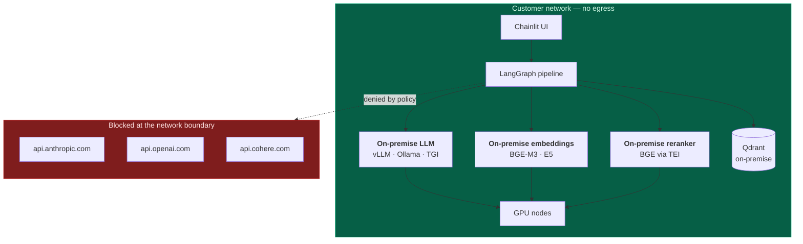
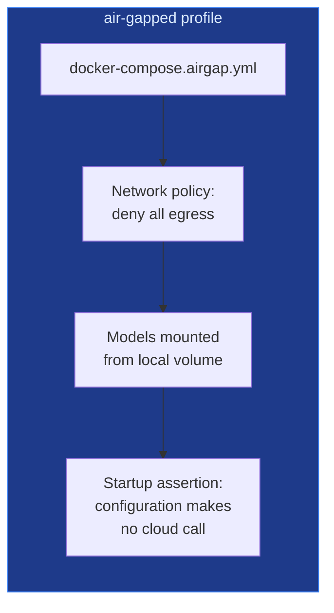

# Corporate LLM & data residency

> **Status: planned, not implemented.** This page describes the design, because it is the
> single most common blocker in enterprise procurement of a tool like this.

## The objection, stated properly

A consultancy evaluating this platform will ask one question before any other:

> *"Where does our client's data go?"*

Today's honest answer is uncomfortable. With cloud providers configured, the brief — which
routinely contains client names, budgets, system names, and personal-data descriptions —
is sent to Anthropic and OpenAI. For a German consultancy serving a public-sector client, or
a supplier bound by a data processing agreement that restricts sub-processors, that answer
ends the conversation.

Bolting on "we support Ollama" does not resolve it. The concern is not whether a local model
*can* be called. It is whether the operator can **prove** that no client data left the
building, and whether the platform helps them do so.

## Design



### What already exists

The groundwork is in place — this is an extension, not a rewrite:

| Capability | Status |
| :-- | :-- |
| `SOWSPRINT_OPENAI_BASE_URL` pointing at any OpenAI-compatible server | **Works today** |
| `OllamaClient` for the on-premise guardrail tier | **Works today** |
| `SOWSPRINT_WHISPER_BASE_URL` for self-hosted speech-to-text | **Works today** |
| `SOWSPRINT_TEI_RERANK_URL` for self-hosted reranking | **Works today** |
| Local embedding provider interface | **Interface exists**, needs a local model |
| Deterministic offline engine — no network at all | **Works today** |
| Per-provider egress policy enforcement | **Not built** |
| Air-gapped deployment profile | **Not built** |

The providers are already adapters behind a common interface, so adding a fully local stack
is configuration plus one embedding adapter — not an architectural change.

### What needs building

**1. Provider policy, declared rather than assumed**

```toml
# config/providers.toml — reviewed by security, enforced by the application
[policy]
mode = "on_premise_only"          # or "hybrid", "cloud_permitted"
allow_egress = false
fail_closed = true                 # refuse to run rather than silently use the cloud
```

A `fail_closed` deployment that cannot reach its local model **stops** rather than falling
back to a cloud provider. Silent fallback is precisely the behaviour that would make the
guarantee worthless, and it is what the current `FallbackLLMClient` does by design for
availability. The two behaviours must be distinguishable and configurable.

**2. Egress audit log**

Every provider call records: which provider, which endpoint, which node, token counts, and
whether the payload left the host. Exportable as evidence for a data protection officer.
The structured logging already emits the events; this adds a tamper-evident export.

**3. A deployment profile that proves isolation**



The startup assertion matters most: on boot, the platform verifies that the resolved
configuration contains no cloud provider and **refuses to start** otherwise. An operator
should be able to demonstrate compliance by showing a log line, not by reading
configuration.

**4. Quality expectations, documented honestly**

A 7B–70B local model will not audit as well as a frontier model. The platform must not
pretend otherwise:

- The capability matrix already reports the resolved provider and marks offline fallbacks
- The degraded-audit flag already distinguishes "audited" from "checked against a template"
- The UI must state the tier in use, so a reviewer calibrates their trust accordingly

The right framing for a buyer: **on-premise gives you a strong first-pass review with a
guaranteed data boundary; a frontier model gives you a better review with a data-processing
agreement.** Both are legitimate. Claiming the local model matches the frontier model would
be a lie that surfaces at the worst possible moment.

## Hardware envelope

| Deployment | Model class | GPU | Suitable for |
| :-- | :-- | :-- | :-- |
| Laptop / pilot | 7–8B quantised | none (CPU) or 8 GB | Demonstrating the flow, drafting short contracts |
| Team server | 13–34B quantised | 1 × 24 GB | Real drafting, EU-regime engagements |
| Production | 70B quantised, or a frontier model on-premise | 2 × 48 GB | Full quality on dual-regime contracts |

Embeddings and reranking are cheap and run comfortably on the same node. Speech-to-text via
`whisper-large-v3` on CPU is adequate for dictation.

## Why this is the highest-value roadmap item

The other items on the roadmap make the product better. This one makes it **procurable** in
the segment with the largest budgets and the strictest requirements: regulated industries,
the public sector, and any consultancy whose clients impose sub-processor restrictions.

It is also the item that most cleanly demonstrates engineering judgement, because the
design starts from the customer's actual objection — *prove nothing left the building* —
rather than from a feature list.

→ [Roadmap](Roadmap.md) · [Security](Security.md)
