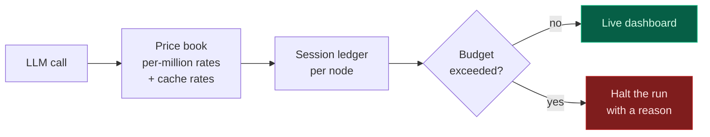
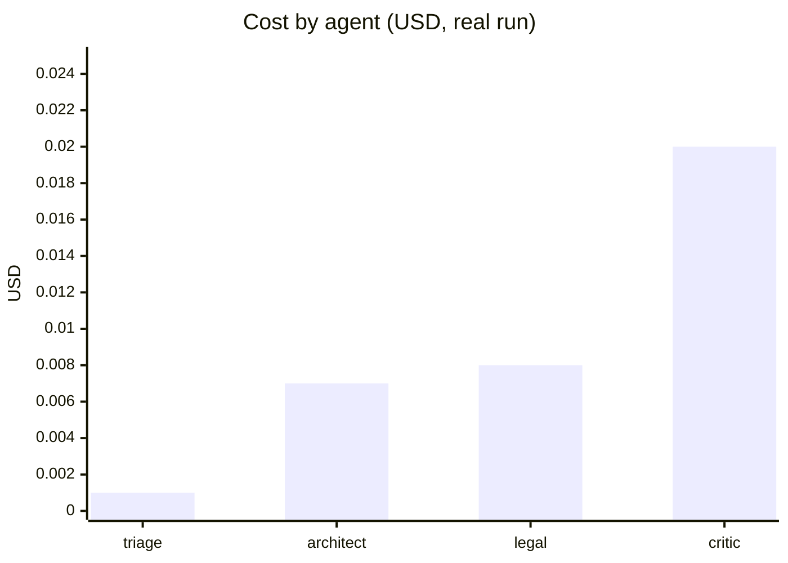
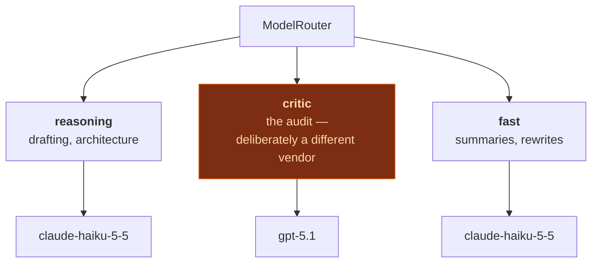

# Cost & observability

## Why spend is a first-class feature

An agentic system that makes twenty model calls per engagement and reports a single number
at the end is unmanageable. Nobody can answer "why did this cost four times the last one?"
or "what would we save by using a cheaper model here?"

So every call is priced as it happens, attributed to the node that made it, and shown to the
user while the run is in progress.



`BudgetExceededError` propagates rather than being swallowed. Hitting a ceiling stops the
run; it does not silently degrade to a cheaper path, because an unattended spend overrun is
worse than a stopped engagement.

## What the dashboard shows


| Metric | Why it is there |
| :-- | :-- |
| Session cost and budget bar | Colour shifts as the ceiling approaches |
| Token split (prompt / completion) | Completion-heavy calls mean the prompt is not doing its work |
| LLM calls | An unexpected count usually means retries |
| Average latency | Distinguishes a slow model from a slow pipeline |
| **Prompt-cache hit** | Shows what caching avoided spending, in dollars |
| **Cost by agent** | The single most actionable view — it answers "where is the money going?" |

On a real EU engagement the breakdown is instructive:



**The audit costs more than the drafting**, and that is the intended allocation. A false
positive in the audit costs a full contract rewrite; a slightly cheaper judge is a bad
trade. The earlier configuration used a cheap model for the judge and produced exactly that:
a hallucinated missing clause that triggered a rewrite and left the score unchanged.

## Prompt caching

Anthropic requires an explicit cache breakpoint; OpenAI caches automatically. The system
marking is on the persona-plus-schema prefix, which is byte-identical on every call to a
node — across retries, clarification rounds, repair loops and successive engagements.

Measured:

```
call 1: in=12790  cached=0     write=4071   cost=$0.048430
call 2: in=12790  cached=4071  write=0      cost=$0.044265   ← $0.0042 cheaper
```

Stated honestly: the static prefix is a small share of a 20k-token legal prompt, so the
saving is modest in absolute terms — roughly **5–8% of input cost**. It is free and it
compounds on long sessions, but calling it a major optimisation would be an overstatement.
The dashboard shows the real number rather than a claim.

## Model routing

Three tiers, because one model for everything is either wasteful or inadequate:



**Judge independence is a configuration guarantee, not a documentation claim.** A model
auditing its own output is measurably weaker at catching its own hallucinations, so
`SOWSPRINT_CRITIC_PROVIDER` exists to route the judge to a different vendor. Setting a
cross-vendor model id *without* that setting posts the id to the wrong API — the capability
matrix reports the resolved pair so the mistake is visible.

Per-node token budgets exist because `max_tokens` is a ceiling, not a reservation. The
Architect needs roughly 12,300 tokens for a real blueprint; at the original 4,096 the JSON
was cut mid-string. Each node now carries a budget, and a truncation escalates the budget
rather than re-prompting identically.

## Pricing accuracy

The price book is maintained by hand and tested against known values. Two bugs found:

- **Substring over-matching.** A lookup for `some-o3-ish-model` matched `o3` rates. Fixed
  with prefix matching plus delimited-segment comparison and a minimum segment length.
- **Offline calls were unpriced.** The deterministic engine consumes no billable tokens, but
  showing `$0.00` implied the work was free. Offline pricing is now **shadow-priced** and
  labelled `simulated`, so the dashboard reflects what the run *would* have cost.

## Honest accounting of the fallback

When a cloud provider fails and the run degrades to the offline engine, the ledger records
the offline call at simulated rates. The dashboard marks it. A reader can distinguish a
cheap run from a run that quietly did less work — which matters, because the offline
auditor is a template matcher, not a real audit.
→ [Quality assurance](Quality-Assurance)

→ [Roadmap](Roadmap) · [Operations](Operations)
