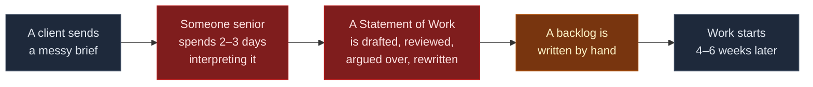
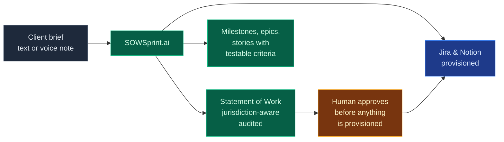

# SOWSprint.ai — Engineering & Product Wiki

> **Autonomous multi-agent platform that turns a raw B2B requirement into an enforceable
> Statement of Work and a deployable agile backlog, with jurisdiction-aware legal
> grounding.**

This wiki is written for two audiences and kept deliberately separate from the
[README](https://github.com/SergeyGer/SOWSprint.ai#readme), which is the business-facing
overview.

| If you are… | Start here |
| :-- | :-- |
| **Evaluating the product** | [Business case](Business-Case) · [Who it is for](Who-It-Is-For) |
| **Reviewing the engineering** | [Architecture](Architecture) · [Agent pipeline](Agent-Pipeline) |
| **Checking the hard parts** | [Compliance-aware RAG](Compliance-RAG) · [Quality assurance](Quality-Assurance) |
| **Operating it** | [Deployment & operations](Operations) · [Security](Security) |
| **Planning what comes next** | [Roadmap](Roadmap) · [Corporate LLM](Corporate-LLM) |

---

## The problem in one diagram

Every day spent interpreting a brief is a day not spent delivering, and every ambiguity
that survives into a signed contract becomes a change request later. The cost is real but
invisible: it hides in "pre-sales effort" and resurfaces as scope disputes.

## The same flow, with the platform

**Measured on this build:** 90–210 seconds and roughly **$0.05–0.20** of model spend for a
complete engagement, against an industry norm of two to three person-days.

---

## What makes it more than a wrapper around a language model

Four things, each of which took real engineering rather than a prompt:

1. **Jurisdiction is enforced inside the vector engine, not requested in a prompt.**
   A clause from the wrong regime cannot reach the drafting agent, because the filter is
   applied at query time on both retrieval arms.
   → [Compliance-aware RAG](Compliance-RAG)

2. **The judge verifies itself.** A claim that a mandatory clause is missing is
   cross-checked against the document before it is trusted. Observed live: a judge
   reported eleven mandatory clauses absent from a contract that contained all of them.
   → [Quality assurance](Quality-Assurance)

3. **A deterministic engine runs the whole pipeline with no credentials.** The test suite
   is credential-free, CI needs no secrets, and the system is demonstrable offline.
   → [Architecture](Architecture)

4. **Nothing touches a customer's systems without a human.** The approval gate lists
   every planned call before it happens.
   → [Integrations](Integrations)

---

## Status

| | |
| :-- | :-- |
| Tests | **483 passing**, no network and no credentials required |
| Live verification | 12/12 protocol checks · 8/8 voice checks · browser-level DOM checks |
| Corpus | 615 indexed passages across EU and US regimes |
| CI | tests on 3.11 and 3.12, end-to-end engagement, Docker build, CodeQL |
| Licence | MIT |

Last updated: this build. Every figure on this page is reproducible from the
repository.
