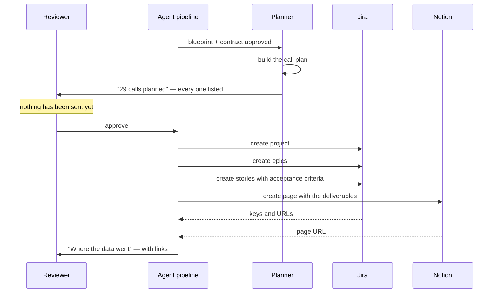
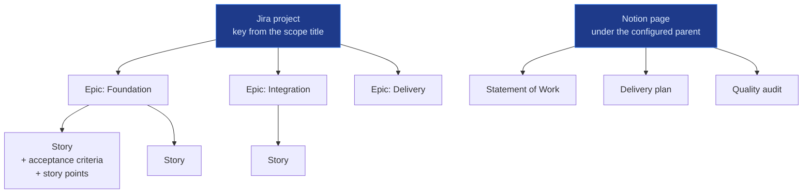

# Integrations

## Jira and Notion, with a gate in front



**Dry-run is the default.** Payloads are validated and shown, then discarded. Going live is
one setting, and the final report states plainly which mode ran:

> ⚠️ **DRY RUN — nothing was sent.** 29 call(s) validated, 0 failed validation.

This wording exists because its predecessor read *"29 call(s) succeeded against
jira+notion"*, which a reader reasonably interpreted as "the backlog was created". It had
not been.

## What gets created



## Tenant adaptation, learned the hard way

Integrations are where a system meets reality, and reality is inconsistent. Each of these
was discovered by running against a real tenant, not by reading documentation.

### Jira requires a project lead, by account id

Project creation failed with:

```json
{"errors": {"projectLead": "You must select an active project lead."}}
```

The request never contained a project lead. The older Jira Server API accepted a `lead`
email; **Jira Cloud v3 requires `leadAccountId`** — an opaque identifier obtained from
`/rest/api/3/myself`. The error names a field that was never sent, so the message alone
does not lead to the fix.

### Story Points is a per-tenant field id

The field is `customfield_10016` on most tenants — and `customfield_10037` on this one.
Writing to the wrong id rejects the **entire issue**, not just the estimate. The connector
now discovers field ids at runtime, and if a tenant has no Story Points field at all, the
estimate is dropped rather than the ticket.

> On one tenant the field was reported absent until a project was created from the Scrum
> template, which added it. Hardcoding would have failed intermittently and inexplicably.

### Notion 404 means "not shared"

A valid Notion key returns **404** until the parent page is explicitly connected to the
integration: open the page → `•••` → **Connections** → connect. The API gives no hint that
this is the problem, and the natural conclusion is that the key is wrong.

### The Starter plan rejects databases

`POST /v1/databases` returns 400 on Notion's Starter plan. The connector creates pages,
which works on every plan.

### Story-to-epic linking differs by project type

Company-managed projects link stories to epics through an **Epic Link custom field**.
Team-managed projects use the **Parent** field. The connector uses `parent`, which matches
the team-managed projects this build is verified against; a company-managed tenant needs the
custom field instead.

## Getting the backlog in without the API

The generated `jira_backlog.csv` is written for the connector, not for Jira's manual
importer. Three of its columns break a manual import:

| Column | Problem |
| :-- | :-- |
| `Issue Key` | Jira reads a mapped key as *update this issue*, so every row fails against a project that does not have those keys |
| `Story Points`, `Epic Link` | Custom fields that may not exist |
| `Acceptance Criteria` | Almost never a field in a fresh tenant |

```bash
make jira-csv    # writes an importer-safe variant
```

It drops the keys, folds acceptance criteria into the description, and with
`--team-managed` rewrites the epic link as a parent summary — the only identifier that
exists before Jira assigns keys.

## Not configuration: file attachments

The connector creates projects, epics and stories. It does **not** attach files. Uploading
the generated PDF to an issue is a manual step, or a small addition using
`POST /rest/api/3/issue/{key}/attachments`. Stated plainly rather than left to be
discovered.

→ [Operations](Operations.md) · [Roadmap](Roadmap.md)
