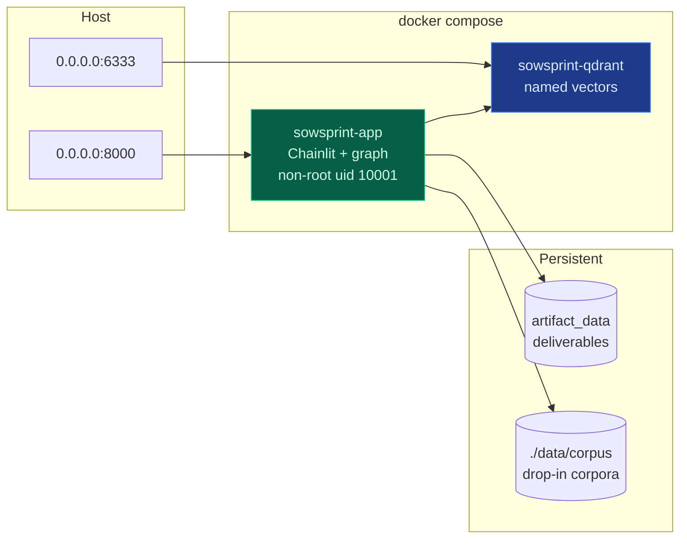
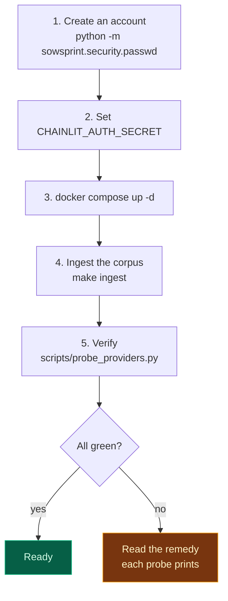
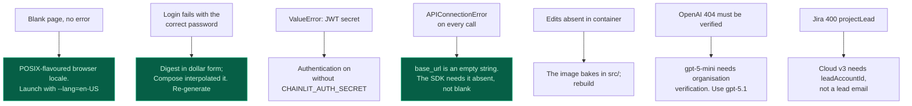

# Deployment & operations

## Two containers, one command



```bash
docker compose up -d
```

The app binds `0.0.0.0` deliberately, so a phone on the same Wi-Fi can dictate a brief.
Qdrant is exposed so the index can be inspected and rebuilt without entering the container.

## First run



`scripts/probe_providers.py` makes one minimal real call per configured service and prints
the **specific remedy** for the failures this project has actually hit — the OpenAI
organisation-verification 404, the Jira account-email 401, the Notion page-not-shared 404.
A full pass costs about $0.0001.

## Container behaviour worth knowing

These caused real confusion during development and are worth internalising:

| Behaviour | Consequence |
| :-- | :-- |
| The image **bakes in** `src/`; it is not a bind mount | Source edits need `docker compose build`, not just `up -d`. A fix that works locally appears not to work in the container |
| `docker compose exec` runs in the **existing** container | It does not re-read `.env`. An edited credential appears to have no effect |
| Readiness warms the index | The container reports healthy only when it can actually draft, not merely answer HTTP |
| `data/corpus` is mounted read-only | Drop-in corpora need no rebuild |

`docker compose up -d --force-recreate` is the correct response to any `.env` change.

## Health and readiness

```bash
docker compose exec sowsprint-app python scripts/healthcheck.py --deep
```

```
[OK ] liveness: http 200
[OK ] readiness: {"store": "qdrant", "chunks": 615, "bm25_fitted": true,
                  "eu_probe": "6a0638b72bca", "us_probe": "defea8be8215"}
```

The deep probe goes further than "is the port open": it asserts the corpus is indexed, the
BM25 statistics are fitted, and **both jurisdictions return distinct results**. That last
check is what catches a filter that has silently stopped working.

## Rebuilding the index

```bash
make reingest          # required after changing the embedding provider or dimension
```

An index built with one embedding model is meaningless with another. The dimension is
enforced at collection creation, so a mismatch fails loudly rather than returning nonsense.

## Observability

Structured logs with stable event names, greppable in production:

```bash
docker compose logs sowsprint-app | grep -oE '"event": "[a-z._]+"' | sort | uniq -c | sort -rn
```

Events worth alerting on:

| Event | Meaning |
| :-- | :-- |
| `auth.failed` | Repeated failures may be an attack or a misconfigured client |
| `llm.degraded_to_offline` | A cloud provider failed; quality has dropped |
| `critic.degraded_audit` | The audit is not a real audit — the verdict is unreliable |
| `llm.output_truncated` | A budget is too small for a node |
| `jira.story_points_field_absent` | Tenant adaptation engaged; estimates are being dropped |

## Backup and recovery

The state that matters is the artifact volume and the corpus. Neither is large.

```bash
docker run --rm -v sowsprint_artifact_data:/data -v "$PWD:/backup" alpine \
  tar czf /backup/artifacts-$(date +%F).tar.gz -C /data .
```

Qdrant can be rebuilt from the corpus at any time, so it does not need backing up.

## Failure modes and their responses



Every one of those was hit and diagnosed during this project's development. The failure
table exists because the error messages alone do not lead to the fix.

→ [Security](Security.md) · [Testing](Testing.md)
