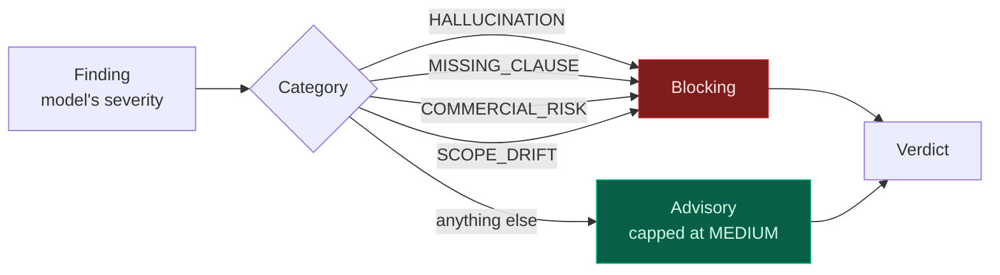
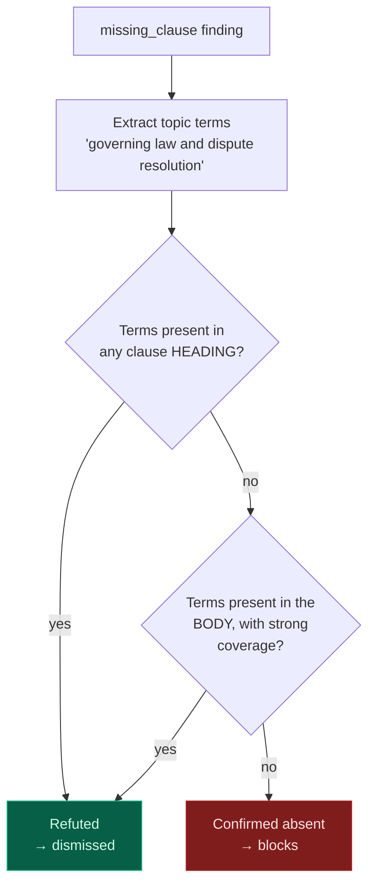

# Quality assurance

The audit is the component most likely to be trusted and least likely to deserve it. Most
of the engineering effort in this project went here, and every guard exists because of a
specific observed failure.

## The failure mode that motivates everything

A language model asked to audit a contract will find real defects. It will also invent
them, with total confidence and precise-sounding clause references.

Observed live, in this order:

| # | What the judge claimed | What was true |
| --: | :-- | :-- |
| 1 | CRITICAL: "no clause addressing governing law and dispute resolution" | Clause 25 is titled exactly that |
| 2 | Eleven mandatory clauses absent: Definitions, Scope, Fees, Termination… | All eleven present |
| 3 | Score 0.00, 12 findings, run failed | Eleven findings were refuted; the score was never revisited |

Each of those produced a guard. None of them was hypothetical.

## Guard 1 — the category decides, not the label

A judge is reliable about *what* is wrong and unreliable about *how much it matters*. The
same defect draws HIGH in one run and CRITICAL in the next, and severity is what gates the
run.

So severity is calibrated from the finding's **category** against a policy, and the



Effect measured on the build: an unsupported payment window previously escalated to HIGH,
forced a full contract rewrite, and left the score unchanged. It is now advisory.

## Guard 2 — verify the claim against the document

A `missing_clause` finding is a factual claim, and factual claims are checkable
deterministically. The document either contains a clause about "governing law" or it does
not.



A heading match is decisive; a body match requires the terms to be broadly covered, so the
check does not become a way for real gaps to pass. A genuinely absent clause still blocks —
there is a test for exactly that.

**Refuted claims are removed, not downgraded.** The first version downgraded them to LOW,
which was wrong: the finding stayed in the list, counted toward the total, and — critically
— the judge's score, computed when it believed eleven clauses were absent, was left
standing. The contract was failed on `0.00 >= 0.72` for defects that had just been
disproven, and the repair loop was pointed at them.

Refuted claims are now recorded separately as `dismissed`, where they remain visible as
evidence about the judge without weighing on the verdict.

## Guard 3 — derive the verdict from the findings, always

The verdict *and* the score are computed from the findings that survived verification:

```
score = 1 - 0.30 × blocking - min(0.20, 0.05 × advisory)
```

Grounding then caps the result, so a clean findings list cannot hide weak substantiation.
The formula is deliberately simple, because a score nobody can reconstruct is a score
nobody can argue with.

**Always, not only when something was dismissed.** The recomputation used to run only if a
finding had been refuted, so a judge that was merely generous kept its own number: one live
run reported `0.78` beside "1 high, 3 medium, 2 low" where the formula gives `0.50` — two
definitions of quality for one set of findings. Both agreed on FAILED that time, which is
why it survived, but the disagreement becomes a wrong verdict the moment a threshold moves.

The judge's own number is kept as `raw_quality_score` and shown beside the derived one,
because the gap is informative. The derived score is what the verdict rests on; the judge's
is what a holistic reading of the same document produced.

### Grounding is counted, not estimated

The cap is only as trustworthy as the number under it, and that number was a language
model's estimate of something the document answers exactly: each clause records which
evidence ids it cites, and the document records which ids were retrieved, so the share
whose citations all resolve is arithmetic.

Measured against real runs, the judge was not merely noisy. It reported **1.0** and **0.96**
where the count was **0.44** and **0.50** — overestimating by more than a factor of two, and
always in the direction that lets a weak contract pass. `compute_grounding()` counts it now;
the judge's estimate is kept beside it in `judge_grounding_estimate`, because a judge that is
consistently generous about grounding is worth knowing about.

Two related defects came out of measuring it:

* **Framing clauses were counted as ungrounded obligations.** The exclusion list compared
  headings for equality against `"Definitions"`, and a real draft titled its clauses
  `"Definitions and Interpretation"` and `"Milestones and Delivery Schedule"` — none of which
  matched. Four framing clauses landed in the denominator and the reported ratio was twenty
  points pessimistic. Headings are now matched as substrings of a normalised form.

* **Low grounding was invisible in the findings.** The cap silently lowers the score, so a
  reader saw *"one medium finding"* beside `FAILED` with no way to tell why. Whenever the
  measured ratio is poor and the judge did not already raise it, an `unsupported_claim`
  finding is added naming the ungrounded clauses — so the verdict is explainable from the
  list printed next to it.

### Which of the two decided the outcome

The score is the lower of the findings penalty and the grounding cap, and the two call for
different repairs. Naming the wrong one sends a reader to fix something that is not the
problem, so the verdict says which applied:

| Situation | What the verdict says |
| :-- | :-- |
| A blocking finding | Names the finding; the grounding cap is irrelevant |
| Advisory findings only, score under the bar | The accumulated findings pushed it under |
| The grounding cap is below the findings score | **"The findings are not what failed this"**, naming the grounding ratio |

That third case is real and was hidden before. One live run reported a single medium
finding, a grounding ratio of 33%, and a judge score of 0.88 — the judge's own summary
called it "no blocking defects" while acknowledging that two thirds of the clauses cite
nothing. The findings score is 0.95, the grounding cap is 0.40, and the run fails. It
should: most of that contract is not traceable to anything.

## Guard 4 — detect a judge that did not really run

When the configured judge is unreachable, the pipeline degrades to the deterministic
offline checker. That checker is a rule-based template matcher, and handed a contract
drafted by a language model it reports every clause as missing and scores 0.00.

That is a failure of the audit, not of the contract — and it was previously presented as a
verdict. The report now carries `degraded` and a reason, and the transcript says so **before
the numbers**, because a reader who sees "Score 0.00" first has already drawn the wrong
conclusion.

## What a real finding looks like

From a live run, and the reason the audit earns its cost:

> **low ambiguity (15.1)** — Personal data breach notification uses an internal operational
> reference ("within the internal alerting window of 2 hours from detection set out in
> clause 7 of the Platform runbooks"), but the runbooks and their clause numbering are not
> part of the SOW. This could create argument over when the contractual notification window
> starts and what the specific time limit is.

The obligation is defined by reference to a document the counterparty cannot see or
enforce. A reader in a hurry would not catch that.

## Verification that the guards work

| Test | Asserts |
| :-- | :-- |
| Contradicted finding removed | A refuted claim does not survive into findings |
| Genuinely absent clause still blocks | The guard is not a way for real gaps to pass |
| Score recomputed | Advisory noise alone cannot fail a contract |
| Grounding caps the score | A clean list cannot hide weak substantiation |
| One blocking finding fails | The bar still bites |
| Degraded audit flagged | An offline fallback is not presented as a verdict |

## The honest state of evaluation

**There is no golden-set evaluation yet, and that is the largest gap in this project.**

The unit suite proves the guards behave as specified. It does not prove the audit is
*accurate* — precision and recall against a labelled set of known defects. The recommended
approach is in the roadmap: take sound contracts, inject exactly one known defect, and
measure whether the judge finds that defect and nothing else.

Until that exists, the judge's output should be treated as a strong review aid rather than
a gate — which is exactly why a human approves before anything is provisioned.

→ [LLM quality & reliability](LLM-Quality) — how each number that decides a verdict is
produced, and what is *not* guaranteed

→ [Roadmap](Roadmap) · [Testing](Testing)
