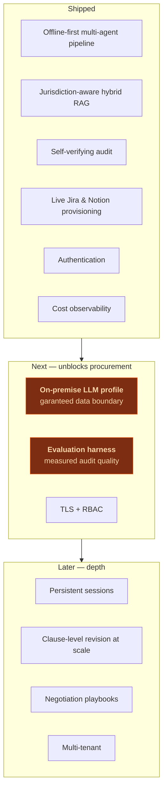
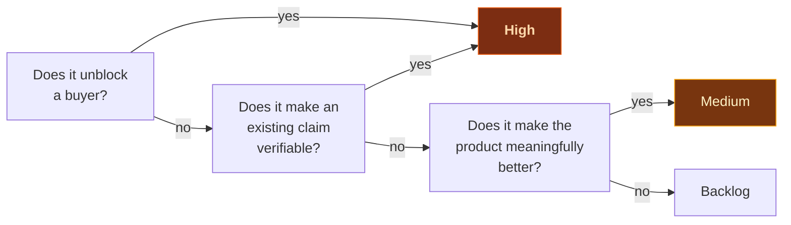

# Roadmap

Ordered by what unblocks adoption, not by what is most interesting to build.

---

## Next

### 1. On-premise LLM and guaranteed data residency
**The highest-value item on this list**, and the one most often raised in enterprise
evaluation. A consultancy cannot send client briefs to a third party without a data
processing agreement that permits it, and many cannot at all.

The groundwork exists — every provider is already an adapter behind a common interface, and
self-hosted Whisper, reranking and OpenAI-compatible endpoints already work. What is missing
is a deployment profile that **proves** isolation: declared provider policy, fail-closed
behaviour, and a startup assertion that the resolved configuration makes no cloud call.

→ [Full design](Corporate-LLM.md)

### 2. Evaluation harness with published results
Audit quality is currently asserted from experience, not measured. Take sound contracts,
inject exactly one known defect into each, and report whether the judge finds that defect
**and nothing else** — precision and recall per release.

This is the difference between "the audit is good" and "the audit detects 87% of injected
defects with a 12% false-positive rate". The second is a claim a buyer can act on.

The synthetic-defect corpus is cheap to build: mechanical injections (remove a mandatory
clause, corrupt a citation id, break the payment arithmetic) need no legal expertise and
produce an unambiguous ground truth.

### 3. TLS termination and role-based access control
The application serves credentials and contracts over plain HTTP and treats every
authenticated user identically. Both are acceptable for a LAN pilot and neither is
acceptable for a shared deployment. Roles are already recorded in the account model; they
are simply not enforced.

---

## Later

### 4. Persistent sessions
Sessions live in memory, so a restart loses them. Moving the LangGraph checkpointer to
Postgres would give resumable engagements, an audit trail of who approved what, and a
foundation for multi-user deployments.

### 5. Clause-level revision at scale
Locking and targeted edits work. What is missing is a version history across revisions, so
a reviewer can see how a clause evolved through negotiation rather than only the diff from
the previous round.

### 6. Negotiation playbooks
The audit says what is wrong. A playbook would say what to do about it: fallback positions
per clause, what is negotiable and what is not, and which concessions need approval. This is
the artefact legal operations teams actually ask for, and it is a natural extension of the
corpus.

### 7. Multi-tenancy
Deliberately deferred. Tenancy is a compliance boundary, not a database column, and building
it before understanding the data-residency requirements of the target market would mean
building it twice.

---

## Explicitly not planned

| Not doing | Why |
| :-- | :-- |
| **Fine-tuning a model** | Retrieval plus structured output solves the problem. Fine-tuning adds a training pipeline and a drift surface for no measured gain |
| **Becoming a CLM** | Contract lifecycle management is a mature category with real products. Integrating is cheaper and better than replacing |
| **E-signature** | Same reasoning, and it is a regulated activity |
| **Autonomous provisioning without approval** | The gate is why the platform is deployable in a regulated environment. Removing it to save one click would trade the product's main virtue for a convenience |
| **A general-purpose legal chatbot** | This drafts and audits engagements with deliverables and milestones. A chatbot that answers anything answers nothing reliably |

---

## How this list is prioritised

Two tests, in order: **does it unblock adoption**, and **does it make an existing claim
verifiable**. Features that make the product better without doing either are genuinely
lower priority — and a roadmap that says so is more useful than one that lists everything
as important.

→ [Corporate LLM](Corporate-LLM.md) · [Decisions](Decisions.md)
