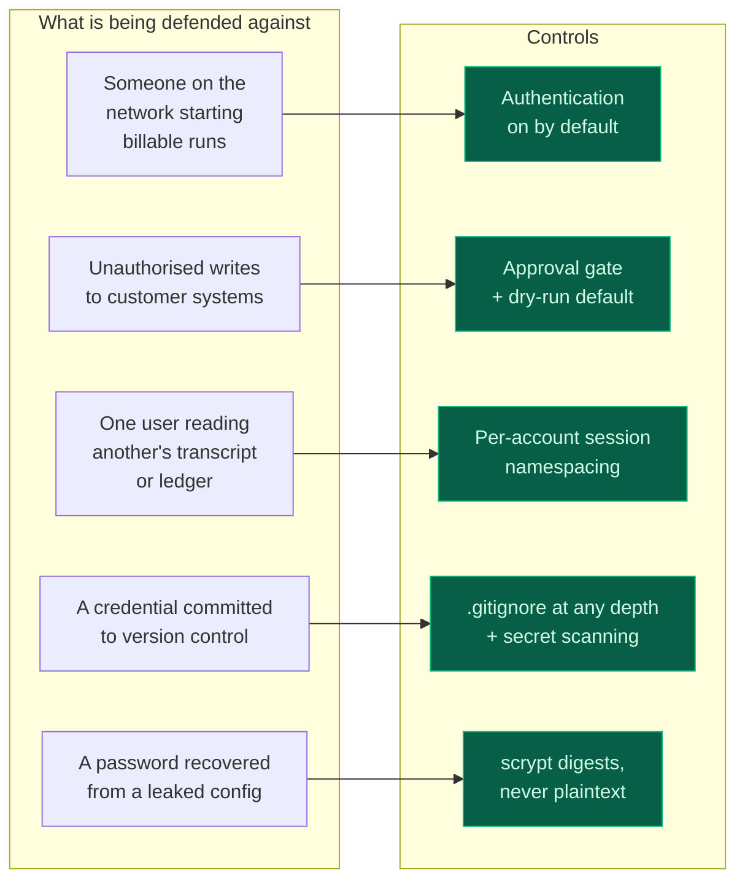
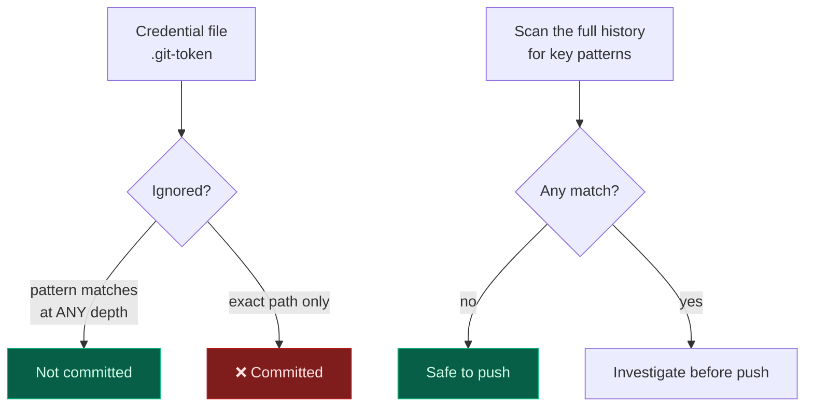

# Security & authentication

## Threat model

The application spends real money on model calls and writes to a customer's Jira and
Notion. It binds `0.0.0.0` so that a phone on the same Wi-Fi can reach it — which is the
intended way to dictate a brief, and also means **anything else on that network can**.

## Two credential paths

| Path | Used by | Mechanism |
| :-- | :-- | :-- |
| `POST /login` | people | username and password against an scrypt digest |
| `POST /auth/header` | harnesses, CI | `X-API-Key`, exchanged for a short-lived cookie |

Machine accounts never carry a human's password. Unattended scripts exchange a key for a
cookie, which is what makes automated verification possible against an authenticated
deployment.

## Design decisions

**`hashlib.scrypt` rather than bcrypt or argon2.** A memory-hard KDF from the standard
library, so the image carries no native build dependency. The digest is self-describing, so
cost parameters can be raised later without invalidating existing passwords.

**The digest separator is a dot, not a dollar sign.** This is not style.

> Digests live in `.env`, which Docker Compose reads with variable interpolation. The
> conventional `scrypt$16384$8$1$…` reached the container as `scrypt`, because Compose read
> `$16384` as an unset variable. Every login then failed **with a correct password**, and
> the only signal was a warning about an unset variable scrolling past in the compose
> output. There is now a test asserting the digest contains no `$`.

**Fail closed at startup.** Authentication enabled with no accounts configured **refuses to
start**, with the command needed to fix it. The first version validated lazily, on the first
login attempt: the container started, passed its health check, served the login form and
rejected every credential. The worst of both — it looked healthy and was unusable.

**Failed logins are throttled** per identity, and every failure path performs a hash anyway,
so response timing does not reveal whether a username exists.

**Sessions are namespaced per account**, so two people on one deployment cannot read each
other's transcripts or cost ledgers, and a budget applies per person.

## Secrets handling

Two lessons from this project, both learned the hard way:

**Ignore patterns must match at any depth.** A token file was placed in `scripts/` rather
than the repository root. The pattern list covered `.env` and `.git-token` at the root only,
and `git add -A` would have committed a live GitHub PAT. A leading slash is the difference
between a safe pattern and a leaked credential.

**Editing `.env` with a pattern match is dangerous.** A section-rewriting regular expression
matched a larger span than intended and silently emptied **ten** credential fields. Nothing
failed loudly; the loss surfaced as "service not configured". `scripts/setenv.py` now
replaces exactly one line, refuses to write when a change would empty a credential, refuses
when a key appears twice, and writes atomically via a temporary file.

## What is not built

Stated because a security page that only lists strengths is not useful:

| Gap | Consequence |
| :-- | :-- |
| **No TLS termination** | Deploy behind a reverse proxy. Credentials and contracts cross the LAN in clear text otherwise |
| **No role-based access control** | Roles are recorded but every authenticated user can do everything, including provisioning |
| **No audit log of user actions** | Provider calls are logged; who approved what is not persisted beyond the run report |
| **In-memory session state** | A restart loses active sessions; there is no database |
| **No rate limiting** | A budget caps spend per session, but nothing caps the number of sessions |
| **API keys are not scoped** | A machine account can do anything a human can |

The first two are the ones to fix before any multi-user deployment.
→ [Roadmap](Roadmap)

→ [Corporate LLM & data residency](Corporate-LLM) · [Operations](Operations)
