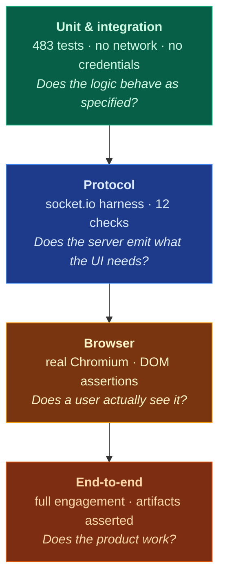
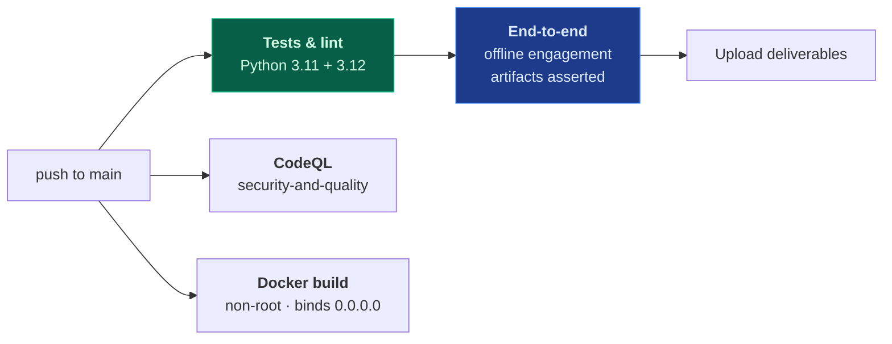

# Testing & verification

## Four layers, each answering a different question



Layer 3 exists because layer 2 **lied**.

> The cost dashboard passed every protocol check for weeks while being completely invisible
> in a browser. The server emitted a Chainlit `CustomElement` with correct props; the
> frontend silently failed to mount it. The socket payload was right and the user saw
> nothing.
>
> A second instance: the post-run browser check asserted an `authentication accepted` that
> could not actually fill the login form — its "no form appeared" path returned success, so
> a broken check reported a pass.

Both were found by looking at what a browser rendered rather than what the server sent. The
lesson is now structural: **assert on the layer the user experiences.**

## What the unit suite covers

| Area | Examples |
| :-- | :-- |
| Graph behaviour | Every node, the repair loop, clarification rounds, the approval gate |
| Retrieval | Hybrid fusion, jurisdiction filtering, dual-regime balance, filter parity between stores |
| The audit guards | Contradicted claims removed, real gaps still block, score recomputation, degraded detection |
| Contracts | Dual-regime template coverage, no duplicate clause concepts, lock enforcement |
| Security | Hashing, verification, throttling, fail-closed startup, the dollar-separator regression |
| Provider config | Empty `base_url` omitted — the bug that broke every OpenAI call |
| Integrations | Jira field discovery, CSV conversion, payload shapes |

## Why the suite needs no credentials

**The offline engine runs the entire pipeline.** Every test resolves to a deterministic
adapter, so:

- CI needs no secrets, and a revoked key cannot turn the build red
- Tests run identically on a laptop, in CI and in a container
- The same graph, schemas and artifacts are exercised on both paths

A hermetic fixture strips ambient `SOWSPRINT_*` variables and disables `.env`. That took a
second pass to get right: importing `app` calls `load_dotenv()`, which puts a developer's
real credentials back into the environment *after* the session fixture has cleaned it — five
unrelated tests then failed against live keys, with the cause nowhere near the symptom. The
environment is now re-neutralised before every test.

## Browser-level verification

Chromium needs system libraries the application image does not carry, so it runs in the
official Playwright image on the same Docker network:

```bash
docker run --rm --network sowsprint_sowsprint-net \
  -e PLAYWRIGHT_BROWSERS_PATH=/ms-playwright \
  -v "$PWD/scripts:/scripts:ro" \
  --entrypoint bash mcr.microsoft.com/playwright/python:v1.49.1-noble \
  -c "pip install -q playwright==1.49.1; python /scripts/verify_visual.py"
```

It asserts that React mounts, the composer is interactive, an engagement reaches the
approval gate, the dashboard markup is in the DOM **with a non-zero layout box**, and no
console errors appeared.

## CI



The end-to-end job asserts the artifacts exist and are non-empty, and that
`statement_of_work.pdf` **actually starts with `%PDF-`** — a real file, not a renamed
placeholder.

### CI earned its place on its first run

It failed, on the Docker job:

```
failed to compute cache key: '/data/corpus': not found
```

The Dockerfile copied `data/corpus/`, which is an **empty directory**. Git does not track
empty directories, so it is absent from a fresh clone. The build had only ever succeeded on
the machine where the directory happened to exist — **anyone cloning the repository had a
broken `docker compose up`**, and no unit test could have caught it. The directory is now
created in the image.

## Test isolation, deliberately

| Rule | Reason |
| :-- | :-- |
| No network, ever | Determinism, and CI without secrets |
| Small corpora by default | Speed; corpus-scale tests are session-scoped |
| Environment re-neutralised per test | `load_dotenv()` on import otherwise leaks credentials |
| No importing `app` in unit tests | It pulls in the whole Chainlit runtime and the developer's `.env` |

→ [Quality assurance](Quality-Assurance) · [Architecture](Architecture)
