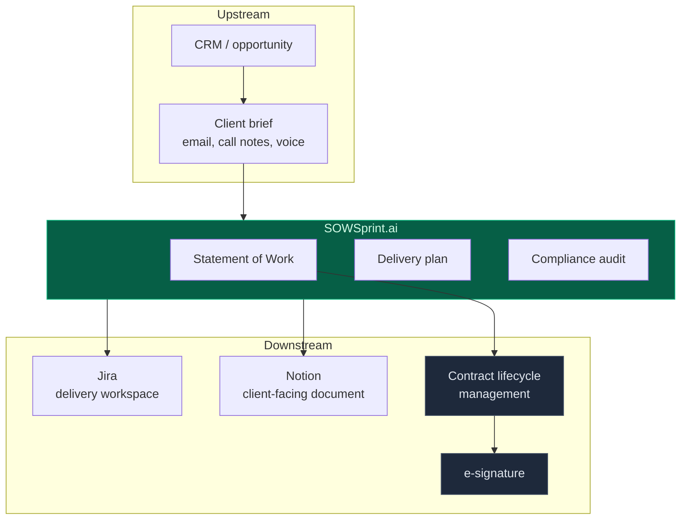

# Who it is for

Five buyer profiles, with the honest answer for each — including for whom this is the
wrong product.

## 1. Digital consultancies and agencies — the primary fit

**Situation.** 10–200 delivery staff. A partner or principal does pre-sales alongside
billable work. Three to ten proposals a month, each needing a Statement of Work and a
plan.

**The pain.** Pre-sales is unbilled and competes directly with delivery. Proposals go out
late, so they go out thin. Scope disputes emerge mid-project because ambiguity was never
resolved at signature.

**What changes.** The first draft takes minutes instead of days, so the senior person
spends their time on the commercial judgement — price, risk, whether to bid at all —
rather than on typing.

> *"Roughly a day of a principal's time per proposal, and the proposals get better because
> the reviewer starts from an audit rather than a blank page."*

## 2. Managed service providers and systems integrators

**Situation.** Repeatable engagement shapes — onboarding, migration, managed support —
delivered many times a year under a master agreement.

**The pain.** Every engagement re-drafts the same clauses. Variation creeps in. Compliance
posture depends on which delivery lead wrote the document.

**What changes.** Jurisdiction-aware drafting is consistent by construction, and the
compliance corpus is a reviewable artefact rather than a habit. The audit runs every time,
not when someone remembers.

## 3. EU-facing suppliers to US parents — the compliance case

**Situation.** A European entity delivering to a US-headquartered customer. GDPR applies
to the data, SEC disclosure duties apply to the parent, and both bind at once.

**The pain.** This is the case that genuinely breaks template-driven drafting. A contract
that satisfies one regime is not a partial success; it is unenforceable in the other. The
conflict surfaces late, usually during a security review, when renegotiation is expensive.

**What changes.** Selecting the dual-regime mode produces one contract that satisfies
both, with an explicit **stricter-standard rule** for conflicts and a transfer-mechanism
clause naming actual instruments (SCCs, adequacy, the EU–U.S. Data Privacy Framework).
Conflicts are resolved by a stated rule rather than by silently picking a side.

→ [Compliance-aware RAG](Compliance-RAG)

## 4. Procurement and legal operations

**Situation.** A queue of incoming Statements of Work to review, each from a different
supplier, each in a different shape.

**The pain.** Review capacity is the bottleneck, and inconsistency between reviewers is a
real risk.

**What changes.** The audit produces a clause-referenced findings list. The reviewer works
through findings rather than reading for defects. Note: the platform **audits and drafts**;
it is not a contract lifecycle management system and does not replace one.

## 5. Product and engineering leadership

**Situation.** Needing a defensible engineering plan quickly — for a board, an investor, or
a client steering group.

**The pain.** Plans are written after the fact and bear little relation to the contract.

**What changes.** The backlog is derived from the same scope object as the contract, with
acceptance criteria that are testable by construction. The plan and the legal document
cannot drift apart, because there is only one source.

---

## Where this is the wrong choice

Saying so plainly, because a tool recommended for the wrong job is worse than no tool.

| Situation | Why not |
| :-- | :-- |
| **Highly bespoke, long-cycle deals** (M&A, complex outsourcing) | The shape of the deal is the value; a generated first draft adds little and may anchor the negotiation badly |
| **Consumer contracts** | Designed for B2B engagements with deliverables and milestones, not terms of service |
| **You need legal advice** | This audits a draft against a compliance corpus. It does not practise law and the bundled corpus is not legal advice |
| **Regulated drafting where a named lawyer must sign** (court filings, regulated disclosures) | Use it to prepare, not to produce the final instrument |
| **One-off engagements** | The setup cost only pays off when you draft repeatedly |

## Where it fits in the stack

It sits **between** the brief and the delivery tooling. It deliberately does not try to be
a CRM, a CLM or an e-signature provider — those are mature categories with real products,
and integrating with them is cheaper and better than replacing them.

→ [Business case](Business-Case) · [Roadmap](Roadmap)
